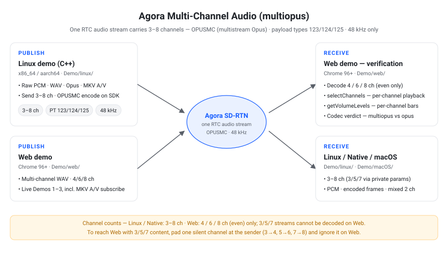

# Agora Multi-Channel Audio (Multiopus) Demo

[中文](README.md)

Delivery repository for the multi-channel audio (multiopus) project, including:

- A C++ demo for 3–8 channel audio send/receive on the Agora Linux SDK
- A Web-side multi-channel verification demo (OPUSMC, payload types 123/124/125, 48 kHz only)
- macOS multi-channel verification apps (Native SDK): MultiChannelAudioReceiver (audience-role receive-only, per-channel playback selection and volume) and MultiChannelAudioSender (broadcaster-role publishing of multi-channel WAV files), bilingual English/Chinese UI with English as default
- The integration specification, cross-platform test summary, and documentation site

## Channel Count Support

- Linux SDK (same as Native): supports 3/4/5/6/7/8-channel send/receive; 3/5/7 require the extra private parameter `che.audio.custom_channel_num` (handled automatically by the demos in this repository).
- Web verification demo: decodes even channel counts (4/6/8) only. A 3/5/7-channel stream does NOT raise an error on the Web side but is **mis-decoded** as the next even channel count (the odd mono substream is read as stereo, duplicating the last channel into a phantom channel) — all volume bars show content and the demo even misjudges it as "multi-channel ✓"; the result is untrustworthy (verified 2026-10-12, see `Docs/audio_multichannel_test_summary.md` §5). Channel-selection features such as `selectChannels` are likewise unusable for such streams. Since 2026-10-12 `Demo/web` ships an `oddChannelFix.ts` runtime patch (all three Live Demos have the switch, on by default) that detects the "identical last-two-channels" phantom signature and corrects the demo-layer verdict display and playback; the SDK itself still does not support odd channel counts — see §4.2 of the summary.
- Interop verification: Web↔Native and Web↔Linux cover 4/6/8 channels; 3/5/7 odd-channel interop was verified on 2026-10-12 across all Native↔Linux paths (Linux↔Linux, Linux→macOS, macOS↔macOS, macOS→Linux — per-channel content correct and in the same order; see `Docs/audio_multichannel_test_summary.md`).
- If 3/5/7-channel content must reach Web clients, pad the stream with one silent channel at the sender to reach an even count (3→4, 5→6, 7→8) and have the Web side ignore the padded channel.
- Per-channel listening verification: use `Demo/web/` on Web (even channel counts only); on Native/macOS use the `Demo/macOS/` receiver app (per-channel mute/volume via the private parameter `che.audio.neteq.adjust_decoded_volume`; Native decodes adaptively, including 3/5/7).

## Directory Guide

| Directory | Contents |
| --- | --- |
| `Demo/linux/` | Linux C++ demo: 4 send paths (raw PCM / 16-bit & 24-bit WAV / pre-encoded Opus / MKV A/V send) + 4 receive paths (decoded PCM / encoded frames / mixed audio / A/V receive), x86_64 + aarch64 |
| `Demo/web/` | Web verification demo (Vue3 + Vite, agora-rtc-sdk-ng 4.24.10): multi-channel publish/subscribe, per-channel playback selection, per-channel volume |
| `Demo/macOS/` | macOS verification apps (SwiftUI + AgoraRtcEngine_macOS, CocoaPods): `MultiChannelAudioReceiver` — audience-role receive-only for multi-channel/stereo streams (per-channel control, remote video display, bitrate charts, audio frame dump); `MultiChannelAudioSender` — broadcaster-role publishing of bundled 4/6/8-channel Channel ID WAV files (10 ms pacer + multi-channel private-parameter negotiation; the send-side 2-channel clamp exists only in 4.5.2 and is lifted from 4.5.3) |
| `Demo/iOS/` | iOS verification apps (SwiftUI + AgoraRtcEngine_iOS 4.7.0, CocoaPods, iOS 14.0+): `MultiChannelAudioReceiverApp` and `MultiChannelAudioSenderApp`, ported from the macOS pair (feature-parity; multi-channel behavior on iOS is subject to verification) |
| `Demo/docs/` | Multi-channel integration documentation site (built with the Web app and published to `dist/docs/`) |
| `Docs/` | Multi-channel integration specification and cross-platform test summary |
| `LinuxSDKFolder/` | Original Agora Linux SDK v4.4.30.152 ZIP archives (X86_64 / Aarch64, extracted and normalized automatically during builds; legacy TGZ supported) |
| `References/` | Multi-channel design documents and Chromium/WebRTC technical references (excluded from the Docker build context) |

## Quick Start

- Unified integration specification: see `Docs/audio_multichannel_spec.md`; cross-platform results and open issues: see `Docs/audio_multichannel_test_summary.md`
- Linux demo build and run: see `Demo/linux/README.md` ([English](Demo/linux/README.en.md))
- Web demo startup and dual-tab verification: see `Demo/web/README.md` ([English](Demo/web/README.en.md))
- macOS app builds and per-channel listening/sending: see `Demo/macOS/README.md` ([English](Demo/macOS/README.en.md)) and `Demo/macOS/MultiChannelAudioSender/README.en.md` ([中文](Demo/macOS/MultiChannelAudioSender/README.md))
- iOS app (Sender/Receiver) builds: see `Demo/iOS/README.md` ([English](Demo/iOS/README.en.md))
- End-to-end verification (Linux sends → Web subscribes and checks each channel): see the two READMEs above and the `Demo/docs/` documentation site

---
