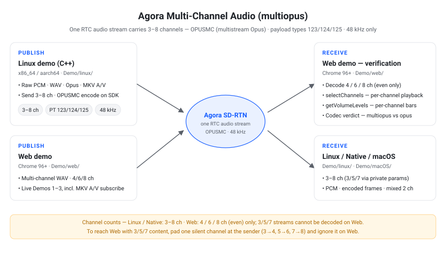

# Agora 音频多声道（Multiopus）Demo

[English](README.en.md)

音频多声道（multiopus）项目交付仓库，包含：

- Agora Linux SDK 3~8 声道音频收发 C++ demo
- Web 端多声道验证 demo（OPUSMC，payload type 123/124/125，仅 48 kHz）
- macOS 多声道接收验证 app（Native SDK，观众角色纯接收，逐声道选择收听与音量调节，中/英文 UI，默认英文）
- 配套文档站与部署资料

## 声道数支持说明

- Linux SDK（Native 同）：支持 3/4/5/6/7/8 声道收发；3/5/7 需额外设置私参 `che.audio.custom_channel_num`（本仓库 demo 已按声道数自动处理）。
- Web 验证端：仅支持 4/6/8 偶数声道解码。Linux 发送的 3/5/7 声道流 Web 端无法解码（解码器未实现奇数声道的 Opus 多流配置），`selectChannels` 等声道选择能力也随之不可用。
- 实际互通验证（Web↔Native、Web↔Linux）仅覆盖 4/6/8 声道，3/5/7 未实测。
- 若 3/5/7 声道内容需要触达 Web 端，建议发送端补一路静音声道凑成偶数声道（3→4、5→6、7→8）后发送，Web 端忽略该静音声道即可。
- 逐声道收听验证端：Web 用 `Demo/web/`（仅偶数声道）；Native/macOS 用 `Demo/macOS/` 接收 app（基于私参 `che.audio.neteq.adjust_decoded_volume` 逐声道开关与音量，Native 自适应解码，含 3/5/7）。

## 目录导航

| 目录 | 内容 |
| --- | --- |
| `Spec/` | 需求规格（PRD）：Linux SDK、Web SDK 与 Native SDK（macOS）音频多声道 |
| `Demo/linux/` | Linux C++ demo：发送 3 路径（raw PCM / WAV 16bit/24bit / 预编码 Opus）+ 接收 3 路径（解码 PCM / 编码帧 / 混音），x86_64 + aarch64 |
| `Demo/web/` | Web 验证 demo（Vue3 + Vite，agora-rtc-sdk-ng 4.20.1-200）：多声道发布/订阅、声道选择播放、逐声道音量 |
| `Demo/macOS/` | macOS 接收验证 app（SwiftUI + AgoraRtcEngine_macOS 4.5.2，CocoaPods）：观众角色纯接收多声道/立体声流，逐声道选择收听与音量调节，音频帧 dump |
| `Demo/docs/` | 多声道接入文档站（随 Web 构建发布到 `dist/docs/`） |
| `Docs/` | 部署与运维文档（AWS 测试服务器部署、前端缓存管理） |
| `LinuxSDKFolder/` | Agora Linux SDK v4.4.30.149（X86_64 / Aarch64，含符号包） |
| `References/` | 参考材料（历史 sample、设计文档、沟通记录的文字化备份，不入 Docker 构建上下文） |

## 快速开始

- Linux demo 构建与运行：见 `Demo/linux/README.md`（[English](Demo/linux/README.en.md)）
- Web demo 启动与双标签页验证：见 `Demo/web/README.md`（[English](Demo/web/README.en.md)）
- macOS 接收验证 app 构建与逐声道试听：见 `Demo/macOS/README.md`（[English](Demo/macOS/README.en.md)）
- 端到端验证（Linux 发送 → Web 订阅逐声道核对）：见上述两份 README 与 `Demo/docs/` 文档站
