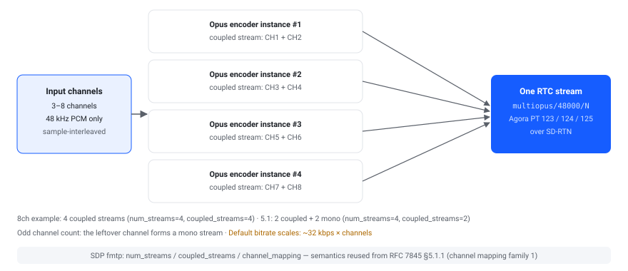
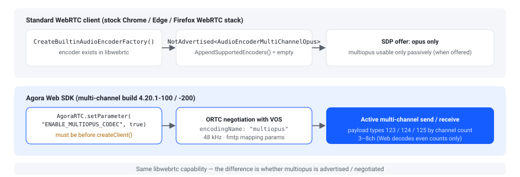
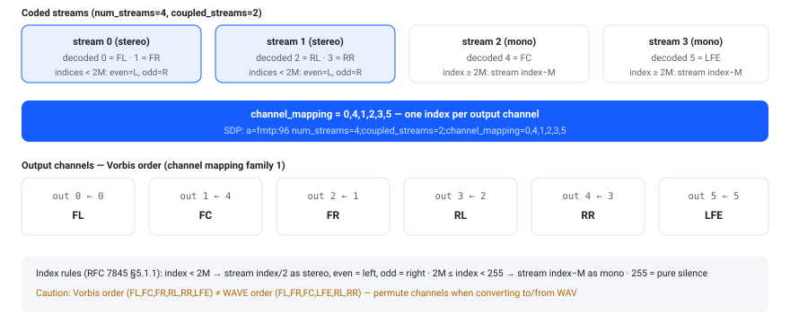
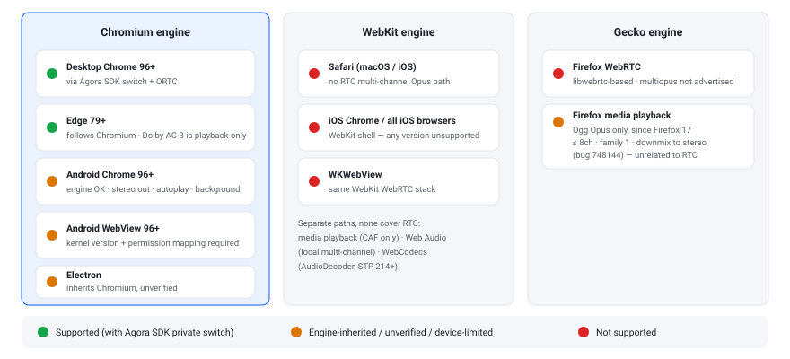

# Chromium / WebRTC 音频多声道（multiopus）参考资料汇总

> 整理日期：2026-10-09（2026-10-09 补充：Firefox 设计细节、RFC 7845 §5.1.1 语义、
> Chrome flag 版本线、Safari / Edge 支持情况、移动端 WebView 与移动端浏览器、
> 长期规划与承诺评估。同日复核：修正 Firefox WebRTC 基线版本、软化未经核验的
> CL 日期与 "8 年" 表述、IAMF 落地消息补充来源归属、flag 引文裁至已核验部分、
> 解码实例数表述精确化等 7 处）
> 用途：为本仓库的 Agora 音频多声道（OPUSMC / multiopus）功能提供 Chromium / WebRTC 侧的
> 技术背景参照——Google libwebrtc 的 multiopus 实现是 Agora Web SDK 多声道能力
> （`ENABLE_MULTIOPUS_CODEC`、ORTC `encodingName: "multiopus"`）所依赖的底层机制。

---

## 1. 概述：什么是 multiopus

- **multiopus** 是 Google 为 libwebrtc 开发的**非标准化** Opus 多声道（multistream）RTP/SDP
  封装约定。RFC 7587（Opus over RTP）只标准化了单声道/立体声信令；多声道部分由 libwebrtc
  以私有 SDP 编码名 `multiopus` + fmtp 参数（`num_streams` / `coupled_streams` / `channel_mapping`）
  实现，声道映射语义复用 RFC 7845（Ogg Opus 封装）的 channel mapping family 1。
- 编码原理：每两个声道由一个 Opus 编码器实例编码为一个 coupled stream，奇数声道时剩余一路
  单独成流（mono stream）。例如 5.1（6 声道）= 2 coupled + 2 mono = `num_streams=4`。
- GStreamer 官方文档对 multiopus 的定位描述（[rtpopuspay](https://gstreamer.freedesktop.org/documentation/rtp/rtpopuspay.html)）：

  > the element supports multichannel Opus audio streams using a non-standardized
  > SDP config and "MULTIOPUS" codec developed by Google for libwebrtc.



*Figure: multiopus multistream encoding — every two channels are encoded by one Opus encoder instance as one coupled stream (8-channel example).*

---

## 2. WebRTC 官方功能追踪

### 2.1 主 issue：Multi-channel audio support in WebRTC

- 现地址：<https://issues.webrtc.org/issues/42233792>
- 旧地址（bugs.chromium.org 时代）：<https://bugs.chromium.org/p/webrtc/issues/detail?id=8649>
- 内容：跟踪 WebRTC 基于 Opus 的环绕声/多声道流支持；提到
  `WebRtcOpus_GetSurroundParameters` 作为按声道数推导 multistream 参数的配置约定。
- 该 issue 创建于 2017-12，2024 年随 WebRTC 缺陷库迁移获得现编号；长期作为功能追踪器存在
  （详见第 7 节对"长期承诺"含义的评估）。

### 2.2 关键 CL：Opus multistream mapping

- <https://webrtc-review.googlesource.com/c/src/+/129768>
- 这是 libwebrtc 引入 multiopus SDP 映射的标志性 CL，被 GStreamer 文档与 IETF draft 作为
  "libwebrtc 的 Opus multistream mapping" 规范来源引用。

### 2.3 相关 issue：OPUS stereo audio over RTP is muxed to mono

- <https://issues.webrtc.org/issues/41481053>
- 讨论采集端多声道被 downmix 的问题；评论中提到 Chrome flag
  `WebRTC multi-channel capture audio processing` 可实现不 downmix 的行为，
  并指出该行为后来已成默认。评论引用的 CL 关联 `Bug: 1194142, webrtc:8133`。

---

## 3. WebRTC 关键源码（附解读）

以下源码均来自 WebRTC 官方仓库（`chromium.googlesource.com/external/webrtc`，
镜像 `github.com/webrtc-mirror/webrtc`，master 分支）。

### 3.1 编码器配置：`AudioEncoderMultiChannelOpusConfig`

文件：[api/audio_codecs/opus/audio_encoder_multi_channel_opus_config.h](https://chromium.googlesource.com/external/webrtc/+/HEAD/api/audio_codecs/opus/audio_encoder_multi_channel_opus_config.h)

```cpp
struct RTC_EXPORT AudioEncoderMultiChannelOpusConfig {
  static constexpr int kDefaultFrameSizeMs = 20;
  static constexpr int kDefaultComplexity = 9;
  static constexpr int kMinBitrateBps = 6000;
  static constexpr int kMaxBitrateBps = 510000;

  int frame_size_ms = kDefaultFrameSizeMs;
  size_t num_channels = 1;
  int bitrate_bps = 32000;
  bool fec_enabled = false;
  bool cbr_enabled = false;
  bool dtx_enabled = false;
  int max_playback_rate_hz = 48000;

  // Number of mono/stereo Opus streams.
  int num_streams = -1;

  // Number of channel pairs coupled together, see RFC 7845 section
  // 5.1.1. Has to be less than the number of streams
  int coupled_streams = -1;

  // Channel mapping table, defines the mapping from encoded streams to input
  // channels. See RFC 7845 section 5.1.1.
  std::vector<unsigned char> channel_mapping;
};
```

校验逻辑（`audio_encoder_multi_channel_opus_config.cc` 的 `IsOk()`）要点：

- `num_streams >= coupled_streams`；`channel_mapping.size() == num_channels`；
- 编码声道总数 = `num_streams + coupled_streams`（mono 流编 1 声道，coupled 流编 2 声道）；
- `channel_mapping` 中的值必须 < 编码声道总数，**255 为特殊值，表示忽略该输入声道**；
- 编码声道与输入声道必须一一对应（逆映射检查），不允许两个输入声道映射到同一编码声道。

### 3.2 SDP 解析与编码参数：`SdpToConfig`

文件：[modules/audio_coding/codecs/opus/audio_encoder_multi_channel_opus_impl.cc](https://chromium.googlesource.com/external/webrtc/+/HEAD/modules/audio_coding/codecs/opus/audio_encoder_multi_channel_opus_impl.cc)

关键逻辑：

```cpp
std::optional<AudioEncoderMultiChannelOpusConfig>
AudioEncoderMultiChannelOpusImpl::SdpToConfig(const SdpAudioFormat& format) {
  if (!absl::EqualsIgnoreCase(format.name, "multiopus") ||
      format.clockrate_hz != 48000) {
    return std::nullopt;
  }
  ...
  // fmtp 必带三个参数，缺一不可，否则拒绝该格式：
  auto num_streams = GetFormatParameter<int>(format, "num_streams");
  if (!num_streams.has_value()) return std::nullopt;
  auto coupled_streams = GetFormatParameter<int>(format, "coupled_streams");
  if (!coupled_streams.has_value()) return std::nullopt;
  auto channel_mapping =
      GetFormatParameter<std::vector<unsigned char>>(format, "channel_mapping");
  if (!channel_mapping.has_value()) return std::nullopt;
  ...
}
```

解读：

- **codec 名必须为 `multiopus`，时钟率固定 48000 Hz**（多声道只支持 48 kHz）；
- fmtp 还识别 `useinbandfec` / `usedtx` / `cbr` / `maxaveragebitrate` / `ptime` /
  `maxplaybackrate` 等常规 Opus 参数；
- **默认码率按声道数线性放大**（同文件注释）：FB 每声道 32 kbps 基准
  （`kOpusBitrateFbBps = 32000`）× 声道数——这解释了多声道流码率明显高于普通 Opus
  （与本仓库 Linux SDK 文档中"多声道码率高、弱网需关注 CC"一致）；
- 声道数 > 1 时 application 自动设为 `kAudio`（即 OPUS_APPLICATION_AUDIO）；
- 实际编码调用 `WebRtcOpus_MultistreamEncoderCreate(num_channels, app, num_streams,
  coupled_streams, channel_mapping)`。

### 3.3 解码器配置校验：`AudioDecoderMultiChannelOpusConfig`

文件：[api/audio_codecs/opus/audio_decoder_multi_channel_opus_config.h](https://chromium.googlesource.com/external/webrtc/+/HEAD/api/audio_codecs/opus/audio_decoder_multi_channel_opus_config.h)

与编码侧同构，唯一区别是 255 的语义：**解码侧 255 表示该输出声道填静音**
（"tells Opus to put silence in output channel x"）。

### 3.4 内置工厂默认不"宣告"：`NotAdvertised<AudioEncoderMultiChannelOpus>`

文件：[api/audio_codecs/builtin_audio_encoder_factory.cc](https://chromium.googlesource.com/external/webrtc/+/HEAD/api/audio_codecs/builtin_audio_encoder_factory.cc)

```cpp
scoped_refptr<AudioEncoderFactory> CreateBuiltinAudioEncoderFactory() {
  return CreateAudioEncoderFactory<
#if WEBRTC_USE_BUILTIN_OPUS
      AudioEncoderOpus, NotAdvertised<AudioEncoderMultiChannelOpus>,
#endif
      AudioEncoderG722, AudioEncoderG711, NotAdvertised<AudioEncoderL16>>();
}
```

**重点**：Chrome/标准 WebRTC 客户端的 SDP offer 里默认**不会宣告** multiopus——
编码器存在但被 `NotAdvertised` 包装（`AppendSupportedEncoders` 为空实现），只能在对端
offer 里看到 multiopus 后被动应答使用。

> 术语说明："advertise" 是 SDP/WebRTC 标准术语，指一端在 SDP offer 的 `m=` 行里
> **声明自己支持哪些 codec**。中文技术社区口语里常直译为"广告"（如 "SDP 广告"），
> 正式文档中更常见的译法是"**宣告**"或"声明"。本文统一用"宣告（advertise）"。
> 源码中的对应实现就是 `AppendSupportedEncoders()`——把 codec 追加进待宣告列表。

这解释了为什么 Agora Web SDK 需要私有开关 `ENABLE_MULTIOPUS_CODEC` 来主动走 multiopus
协商。（解码工厂 `builtin_audio_decoder_factory.cc` 同理。）



*Figure: same libwebrtc capability — the difference is whether multiopus is advertised/negotiated. Above: stock WebRTC (answer-only). Below: Agora Web SDK (active, PT 123/124/125).*

### 3.5 其他相关源码点

- [api/audio_codecs/audio_encoder.h](https://chromium.googlesource.com/external/webrtc/trunk/webrtc/+/f54860e9ef0b68e182a01edc994626d21961bc4b/api/audio_codecs/audio_encoder.h)：
  注释 `Multi-channel audio must be sample-interleaved.`（多声道 PCM 必须逐样本交错——
  与本仓库 Linux 集成指南的 8 声道交错布局要求一致）；
- 单测 `modules/audio_coding/codecs/opus/audio_decoder_multi_channel_opus_unittest.cc`
  （`AudioDecoderMultiOpusTest.InvalidChannelMappings` 等用例展示了非法 mapping 的判定）。

---

## 4. SDP 信令格式与 RFC 7845 声道映射语义

### 4.1 SDP 形态

5.1 / 6 声道示例：

```sdp
a=rtpmap:96 multiopus/48000/6
a=fmtp:96 num_streams=4;coupled_streams=2;channel_mapping=0,4,1,2,3,5
```

7.1 / 8 声道示例：

```sdp
a=rtpmap:111 multiopus/48000/8
a=fmtp:111 num_streams=5;coupled_streams=3;channel_mapping=0,6,1,2,3,4,5,7
```

| 字段 | 含义 |
| --- | --- |
| `multiopus/48000/<N>` | 编码名 / 固定 48 kHz 时钟 / 总声道数 |
| `num_streams` | Opus 流总数（mono + stereo 流） |
| `coupled_streams` | 其中 stereo（coupled）流数量 |
| `channel_mapping` | 逗号分隔映射表，语义遵循 RFC 7845 §5.1.1 |

### 4.2 RFC 7845 §5.1.1 Channel Mapping 语义详解

[RFC 7845 §5.1.1](https://datatracker.ietf.org/doc/html/rfc7845#section-5.1.1)（Ogg Opus
封装的声道映射，multiopus 的 fmtp 三参数直接对应这里的三个字段）定义了三个数量：

- **N = Stream Count（流总数）**：每个包内编码的 Opus 流条数，不允许为 0；
- **M = Coupled Stream Count（耦合流数）**：前 M 条流的解码器按**立体声**（双声道）初始化，
  其余 N−M 条按**单声道**初始化；`M ≤ N`；
- **C = Channel Count（输出声道数）**：声道映射表为每个输出声道提供一个 8-bit 索引
  （共 C 个字节）。

解码声道总数为 **M+N**（前 M 条流各出 2 声道、后 N−M 条流各出 1 声道），必须 ≤ 255。
注意 C 不要求等于 M+N：同一解码声道可以映射到多个输出声道，也可以不被映射。

**映射表索引语义**（设某输出声道的索引为 `index`）：

| `index` 取值 | 含义 |
| --- | --- |
| `index < 2*M` | 取第 `index/2` 条流按立体声解码：**偶数取左声道，奇数取右声道** |
| `2*M ≤ index < 255` | 取第 `index − M` 条流按单声道解码 |
| `index = 255` | 该输出声道**填纯静音** |

**Channel Mapping Family**（ID header 中的一个字节，决定输出声道的语义/摆位）：

| Family | 声道数 | 语义 |
| --- | --- | --- |
| 0 | 1 或 2 | RTP 映射，与 RFC 7587 相同（mono / L,R stereo）；映射表**必须省略**，默认值 N=1、M=C−1、index=0,1 |
| 1 | 1…8 | **Vorbis 声道顺序**的环绕声摆位（见下表） |
| 255 | 1…255 | 声道无定义含义；通用播放器不应播放，离线工具可拆成每声道一个 PCM |
| 2…254 | — | 保留；demuxer 应按 255 处理 |

**Family 1 的标准摆位（Vorbis 顺序）**：

| 声道数 | 布局 | 声道顺序 |
| --- | --- | --- |
| 1 | mono | mono |
| 2 | stereo | L, R |
| 3 | linear surround | L, C, R |
| 4 | quadraphonic | FL, FR, RL, RR |
| 5 | 5.0 | FL, FC, FR, RL, RR |
| 6 | **5.1** | **FL, FC, FR, RL, RR, LFE** |
| 7 | 6.1 | FL, FC, FR, SL, SR, RC, LFE |
| 8 | **7.1** | **FL, FC, FR, SL, SR, RL, RR, LFE** |

关键提醒（RFC 原文明确）：

- **Vorbis 顺序与 WAVE/FLAC 的声道顺序不同**，与这些格式互转时必须对输出声道做置换
  （permutation）。例如 5.1 在 WAVE 中是 FL, FR, FC, LFE, RL, RR，而 Vorbis 顺序是
  FL, FC, FR, RL, RR, LFE——中心声道和 LFE 的位置完全不同；
- "LFE" 指 Low Frequency Effects（低频效果声道，通常接低音炮，无明确空间位置）；
- §5.1.1.5 要求：**播放器必须支持 family 0/1 的任意合法映射**（即使声道数不对应已知
  布局），并给出了多声道→立体声的标准 downmix 矩阵（SHOULD 实现）。

**与 multiopus 的对应关系**：libwebrtc 把 Ogg ID header 里的 N / M / 映射表三个字段
原样搬进了 SDP fmtp（`num_streams` / `coupled_streams` / `channel_mapping`），
family 的概念则隐含为 family 1（环绕声语义）。例如 5.1 的
`channel_mapping=0,4,1,2,3,5`：解码声道序为 stream0 立体声对 (0,1)、stream1 立体声对 (2,3)、
stream2 mono (4)、stream3 mono (5)，即 FL,FR,RL,RR,FC,LFE；映射表 0,4,1,2,3,5 把它重排为
Vorbis 输出顺序 FL,FC,FR,RL,RR,LFE。



*Figure: RFC 7845 §5.1.1 walkthrough — the 5.1 mapping table reorders the decoded channel sequence into Vorbis output order.*

---

## 5. Chrome 浏览器侧：采集多声道 flag

Chrome 提供过实验 flag（`chrome://flags`）：

- flag 名：`#enable-webrtc-capture-multi-channel-audio-processing`
- 标题：**WebRTC multi-channel capture audio processing**
- 描述（[flag_descriptions.cc](https://chromium.googlesource.com/chromium/src/+/1d795bfe6fc5245d292042b5158649b5d232d4fa/chrome/browser/flag_descriptions.cc)）：

  > Support in WebRTC for processing capture audio in multi channel without
  > downmixing when running APM in the render process.

**版本时间线**（基于可查证证据）：

| 节点 | 证据 |
| --- | --- |
| 最迟 **Chrome 85**（stable 2020-08）已存在该 flag | [2020-10-06 在 Chrome 85.0.4183.83 上采集的 chrome://flags 清单](https://gist.github.com/bbaudry/634f1b6107440715d0b45020a0545e62)已包含此项 |
| 2021 年前后功能仍在迭代 | webrtc issue [41481053](https://issues.webrtc.org/issues/41481053) 引用的 CL 关联 `Bug: 1194142, webrtc:8133`（crbug 1194142 为 2021 年 M90/M91 时段的 bug 号段） |
| **M123（2024-03）到期移除**，行为转为默认 | [flag-metadata.json](https://chromium.googlesource.com/chromium/src/+/5e93f02fe938d402228a5428cea87963d51b0ed0/chrome/browser/flag-metadata.json) 中 `expiry_milestone: 123`（owner: saza）；同期 Chromium 自动生成 "Flag expired in M123" 清理 issue；41481053 讨论确认不 downmix 已成默认行为 |

注意区分两个易混淆的 flag：

- `enable-webrtc-capture-multi-channel-audio-processing`（本节的，多声道采集进 APM 不 downmix）；
- `enable-webrtc-apm-downmix-capture-audio-method`（另一个 APM downmix 方法开关，
  同样在 M123 过期，见 [issue 41493988](https://issues.chromium.org/issues/41493988)）。

另外：**此 flag 管"采集端多声道进入 APM 处理不 downmix"**，与编解码的 multiopus
是两个环节。Agora Web SDK 多声道场景下麦克风采集仍是普通用途，multiopus 主要发生在
自定义音轨/文件发布与订阅解码侧。

---

## 6. 标准化动态：IETF draft-shin-avtcore-rtp-multi-opus

- 文档：<https://datatracker.ietf.org/doc/draft-shin-avtcore-rtp-multi-opus/>
  （最新版全文：[draft-shin-avtcore-rtp-multi-opus-03](https://datatracker.ietf.org/doc/draft-shin-avtcore-rtp-multi-opus/03/)）
- 作者：Sun Shin（NVIDIA）；2025-10 首次发布，**最新 -03 版（2026-04-16，有效期至
  2026-10-18）**；个人提交、Intended status: Informational，**未被 AVTCORE 工作组采纳**
  为工作组文档——不构成标准。
- 核心内容：把 libwebrtc 已部署的 `multiopus` 私有 SDP 约定正式化——定义
  `a=rtpmap:<pt> multiopus/48000/<channel-count>` 与 fmtp 三参数，规定 Offer/Answer 流程
  （offer 应同时携带 `opus/48000/2` 作为 stereo 回退；answer 不支持时不得静默降为 stereo），
  并明确引用 webrtc-review CL 129768 作为 libwebrtc 映射语义来源。
- **-03 版新增**（值得跟踪）：
  - §6.1.3 *Mapping Families and Extensibility*：规范性指定 mapping family 1（基于声道的
    扬声器布局），并明确信令机制可扩展到其他 family（如 Ambisonics）而无需改动 RTP
    载荷格式；收到不支持 family 的一端 MUST 在 Offer/Answer 中拒绝该 payload type；
  - §6.1.5 *Field Presence and Constraints*：`channel_mapping` 在 >2 输出声道时**必选**；
    单流 mono/stereo 时可省略（此时按 RFC 7845 family 0 语义解释）；各字段取值 0..255；
    family 1 输出声道数不得超过 8。
  - 引言提到 **MLCODEC 工作组正在定义 Opus 编解码扩展**，未来扩展可复用本 SDP 信令框架。
- RFC 关系（draft 原文）：RFC 6716（Opus 编解码）与 RFC 7845（Ogg 声道映射）定义了
  映射语义但不定义 SDP 信令；RFC 7587 定义 SDP 但只有 mono/stereo；本 draft 补齐
  多声道 RTP/SDP 信令空白。

---

## 7. Chrome/Chromium 对多声道音频的长期规划与承诺评估

结论先行：**Chrome/Chromium 没有公开承诺 RTC 场景多声道（multiopus）的长期路线图**；
它是 libwebrtc 树内一项"稳定但默认不宣告"的能力。把"多声道音频"拆成四条线看，
承诺信号强弱不同：

### 7.1 multiopus（RTC 传输编解码）：无正式承诺，但实质稳定

- 能力在树内维护多年（多声道编解码相关源码的版权年为 2019；2020 年 4 月的
  node-webrtc issue 显示当时第三方已基于它实现 multiopus 互通；CL 129768 的具体合入
  日期未逐一核验）：编码器/解码器、config 校验、单测齐全；GStreamer、Janus 等生态按此
  约定互通——**被移除的风险很低**。
- 但 Google 从未承诺将其默认暴露：`NotAdvertised` 包装多年未变；在 ChromeStatus 上
  未检索到 multiopus 相关条目（未见 origin trial / ship 计划）。
- 功能追踪 issue（2017-12 创建，现 <https://issues.webrtc.org/issues/42233792>）长期
  存在，说明需求被记录但未见排期承诺。
- 对本仓库的含义：Agora 的"私有开关 + 自有 ORTC 协商"路线与 Chrome 默认策略解耦，
  是稳妥的依赖方式；不应假设未来 Chrome 会默认宣告 multiopus。

### 7.2 标准化：IETF draft 持续演进（产业信号，非 Google 承诺）

- draft-shin-avtcore-rtp-multi-opus 从 -00（2025-10）持续更新到 -03（2026-04），
  显示产业界（NVIDIA 主导）在推进标准化；但未被工作组采纳，Google/Chrome 官方没有
  公开背书。
- 若未来被 AVTCORE WG 采纳为工作组文档，互通前景将显著改善——值得持续跟踪
  （见第 6 节 -03 新增内容）。

### 7.3 采集路径：已"转正"，承诺信号最强

- 多声道采集进 APM 不 downmix 已从实验 flag 转为默认行为（flag 于 M123 / 2024-03
  到期移除）——功能毕业为默认，是 Google 对"采集端多声道"最明确的长期承诺形式。

### 7.4 播放/空间音频：Google 的投入在 IAMF/Eclipsa，不在 RTC

- 2025-01 Google 宣布与三星合作的 **Eclipsa Audio（基于 AOM 的 IAMF，免版税空间音频
  格式）将支持 Chrome 与 Android**（[9to5Google](https://9to5google.com/2025/01/19/eclipsa-audio-google-chrome-android/)）。
- 2026-08 Chrome 152 stable 已提供 IAMF 解码（MSE 路径、MP4 容器内 Opus 承载——
  据第三方分析报道，未经 Chrome 官方渠道逐一核验）。
- 说明 Google 的多声道/空间音频战略投入在**媒体播放/流媒体**路径（YouTube 场景），
  与 RTC 多声道是平行赛道；对 multiopus 既不冲突也不直接加持。

### 7.5 综合判断

| 子能力 | 承诺强度 | 依据 |
| --- | --- | --- |
| multiopus RTC 编解码 | 无正式承诺、实质稳定（维护模式） | 树内维护多年（≥2019）、测试齐全、生态互通；ChromeStatus 未检索到条目、默认不宣告 |
| 多声道采集（APM） | 强（已默认） | flag 毕业于 M123 |
| 标准化（RTP/SDP 信令） | 中（产业推进中） | IETF draft -00→-03 持续更新，未获 WG 采纳 |
| 空间/多声道媒体播放 | 强（另一条赛道） | Eclipsa/IAMF 官宣 + Chrome 152 落地 |

建议：本仓库文档与对外表述中，把 multiopus 描述为"libwebrtc 既有能力的私有化启用"，
避免暗示 Chrome 官方支持；同时跟踪 IETF draft（若被 WG 采纳则互通前景显著改善）与
MLCODEC 的 Opus 扩展动态。

---

## 8. Firefox 的多声道设计与实现（Mozilla 侧对照深挖）

Firefox 的多声道 Opus 支持走的是 **Ogg 容器 + `<audio>`/`<video>` 元素**路径，
与 Chrome 的 WebRTC/multiopus 路径完全不同。核心实现记录在
[bug 748144](https://bugzilla.mozilla.org/show_bug.cgi?id=748144)
（"Opus codec in `<audio>` and `<video>` should support multichannel audio"，
RESOLVED FIXED，**target milestone: mozilla17，即 Firefox 17，2012-11 发布**；
贡献者 Alexandros Chronopoulos [:achronop]，mentor: Ralph Giles [:rillian]）。

### 8.1 设计要点（bug 748144 讨论实录）

1. **解析 OpusHead 的声道映射表**：在 `nsOpusState::DecodeHeader` 中读取
   channel mapping family（第 18 字节）、stream count N（19）、coupled count M（20）、
   映射表（21 起共 C 字节）；family 0 时使用默认值（N=1、M=C−1、映射 0,1）。
   family 1 的头长度必须是 19+C 字节，且所有读取前必须做边界检查。
2. **换用 multistream 解码 API**：`opus_decode*` → `opus_multistream_decoder_create()` +
   `opus_multistream_decode[_float]()`，多出的三个入参正是 N / M / 映射表。
   每个包的采样数用 `opus_packet_get_nb_frames × opus_packet_get_samples_per_frame`
   计算（对 multistream 包同样成立——各流帧长可不同，但两者乘积一致，解码时会校验）。
3. **只支持 family 1**：family 0 是已有 mono/stereo；"更高 family 没有定义各声道的
   扬声器摆位，只对多轨混音这类专业应用有用"（rillian）。
4. **>2 声道 downmix 到立体声**：当时 Firefox 音频库只支持 mono/stereo 播放，
   于是借用 **opus-tools 的 downmix 矩阵**（`audio_in.c` 的 `setup_downmix` /
   `read_downmix`），矩阵按行归一化到 2（5~8 声道）；评审中对"归一化 vs 削波 vs 压限"
   有详细讨论。
5. **>8 声道直接拒播**："For > 8 channels we don't have a channel mapping, so I think we
   should just refuse to play such opus streams for now."（与 RFC 7845 family 1 的
   1…8 声道上限一致）
6. **定点采样的 downmix 留作后续**：初版仅支持 float 采样路径（`MOZ_SAMPLE_TYPE_FLOAT`
   未定义时多声道直接 `NS_ERROR_FAILURE`），定点版本由后续
   [bug 790458](https://bugzilla.mozilla.org/show_bug.cgi?id=790458) 跟进。
7. **防御性编程实例**：`mChannels < 1` 必须提前拦截——当时
   `opus_multistream_decoder_create` 对非法参数的 0 长度 alloc 会段错误
   （上游 libopus 后来修复）。
8. 工程细节：链接错误源于 `opus_multistream.h` 缺 `extern "C"` 保护（上游修复前用
   `extern "C" { #include ... }`  workaround）；新符号需加入 `layout/media/symbols.def.in`。

### 8.2 与 Chrome/multiopus 的架构差异

| 维度 | Firefox (bug 748144 路线) | Chrome / libwebrtc (multiopus) |
| --- | --- | --- |
| 载体 | Ogg 容器文件，`<audio>`/`<video>` 播放 | RTP 实时传输，PeerConnection |
| 信令 | Ogg ID header（family + N + M + 映射表） | SDP `multiopus` + fmtp 三参数 |
| 声道语义 | 严格按 RFC 7845 family 1（Vorbis 摆位） | 复用同一映射语义，但由 SDP 携带 |
| 超出播放能力 | 浏览器内 downmix 矩阵 → 立体声 | 无内建 downmix 义务，行为由应用/端决定 |
| 声道上限 | 8（>8 拒播） | SDP 声明的声道数（编码侧 ≤ `kMaxNumberOfChannels`） |

注意：Firefox 的 **WebRTC** 协议栈同样基于 libwebrtc（2013 年 Firefox 22 默认启用 WebRTC
起即如此），因此也受
`NotAdvertised<AudioEncoderMultiChannelOpus>` 限制——不会在 SDP 里主动宣告 multiopus；
其多声道能力体现在媒体文件播放路径，与本仓库的 RTC 场景是两条线。

---

## 9. Safari 对多声道音频的支持

结论先行：**Safari 没有与 multiopus 等价的能力**；其多声道支持分散在媒体播放、
Web Audio、WebCodecs 三条互不相干的路径上，且没有任何一条覆盖"RTC 流内多声道 Opus"。

### 9.1 媒体元素播放（`<audio>`/`<video>`）

- Opus：仅接受 **CAF 容器封装**，且仅 macOS High Sierra（10.13）/ iOS 11 起
  （[MDN Web audio codec guide](https://developer.mozilla.org/en-US/docs/Web/Media/Guides/Formats/Audio_codecs)）。
  CAF 路径走 CoreAudio 系统解码，多声道 CAF Opus 能否按声道输出取决于系统与硬件。
- WebM/Opus：macOS Safari 14.1 起部分支持，**iOS 一直不支持**
  （[WebKit bug 238546](https://bugs.webkit.org/show_bug.cgi?id=238546)，
  2024-03 仍确认 "no support for WebM Opus on iOS"）。
- Ogg 容器：Safari 不支持，因此 Firefox 那条 Ogg 多声道路线在 Safari 上不存在。

### 9.2 Web Audio API（多声道输出/处理）

- Safari（WebKit）很早就支持 Web Audio 的多声道能力：`AudioContext.destination.channelCount`
  可设置，上限为 `maxChannelCount`（随输出设备而变）；`ChannelSplitterNode` /
  `ChannelMergerNode` 可拆分/合并声道（Safari 6 起，webkit 前缀时代）。
- 规范依据：W3C [Web Audio API](https://www.w3.org/TR/webaudio/)——
  `channelCount` / `channelCountMode`（`max`/`clamped-max`/`explicit`）与
  `channelInterpretation`（`speakers` 按摆位上下混 / `discrete` 逐声道直通）。
- 这是"本地多声道处理/输出"，不涉及任何 RTP 传输。

### 9.3 WebCodecs

- WebKit 在 [Safari Technology Preview 214（2025）](https://developer.apple.com/documentation/safari-technology-preview-release-notes/stp-release-214)
  起默认开启 `WebCodecs AudioDecoder`。这为"自有解码管线处理多声道音频"提供了入口，
  但 Opus 多声道解码的具体支持面（声道数上限、映射表语义）未见官方规格说明。

### 9.4 WebRTC

- Safari 的 WebRTC 基于 WebKit 自带的 libwebrtc 衍生栈，**不暴露 multiopus 协商**；
  RFC 7587 之外的 Opus 多声道 RTP 没有任何已被 Safari 采纳的规范
  （唯一的标准化尝试即上文第 6 节的 IETF 个人 draft）。
- 与本仓库能力边界一致：Agora 文档明确 Safari / Firefox 不支持多声道频道
  （加入后行为未定义，可能无声或仅立体声）。

---

## 10. Microsoft Edge：WebRTC 跟随 Chromium，媒体播放有自己的加成

### 10.1 WebRTC / multiopus：跟随 Chromium

- 自 **Edge 79**（2020-01，首个 Chromium 内核稳定版）起，Edge 的 WebRTC 栈就是
  libwebrtc，版本号与 Chromium 一一对应（Edge 96 ≈ Chromium 96）。第三方兼容性评估称
  Edge（Chromium 版）的 WebRTC 实现 "functionally equivalent to Chrome"
  （[Ant Media](https://antmedia.io/webrtc-browser-support/)）。
- 因此 multiopus 的关键行为与 Chrome 一致：内置编码器存在但被 `NotAdvertised` 包装、
  默认不在 SDP 宣告、固定 48 kHz、fmtp 三参数。Agora Web SDK 的
  `ENABLE_MULTIOPUS_CODEC` + ORTC 协商在 Edge 上的行为预期与 Chrome 相同
  （按版本对应关系，"Chrome 96+" 等价于 "Edge 96+"；官方文档若只写 Chrome，
  建议实测 Edge 后再向客户承诺）。
- 未发现 Edge 在 WebRTC **音频/Opus** 侧与 Chromium 有已知偏差。已知的偏差案例在视频侧：
  Edge 即使硬件支持也不通过 WebRTC 发布 H.265/HEVC（[Microsoft Learn Q&A](https://learn.microsoft.com/en-gb/answers/questions/5880331/h-265-hevc-not-published-sent-via-webrtc-chrome-su)）——
  说明 Edge 确实会按需裁剪 WebRTC codec 暴露面，但没有证据表明其动过 Opus/multiopus。

### 10.2 Edge 的特殊之处（属"多声道音频"范畴，但与 WebRTC 无关）

- **Dolby Audio（AC-3 / E-AC-3）**：Edge 通过 Windows 平台解码器（Media Foundation）
  支持 Dolby Digital / Dolby Digital Plus（5.1/7.1 环绕声）的媒体播放，并可结合
  PlayReady DRM（MSE/EME 路径；参见微软官方博客
  [Announcing Dolby Audio for high performance audio in Microsoft Edge](https://blogs.windows.com/msedgedev/2015/05/26/announcing-dolby-audio-for-high-performance-audio-in-microsoft-edge/)）。
  而 AC-3/EC-3 是 Dolby 私有产权，Chromium 本体不集成（社区甚至有给 Chromium 打
  AC-3/EC-3 系统解码补丁的项目：[cjw1115/enable-chromium-ac3-ec3-system-decoding](https://github.com/cjw1115/enable-chromium-ac3-ec3-system-decoding)）。
  这是 Edge 相对 Chrome 在"多声道音频播放"上的真实差异——但属于媒体播放/DRM 路径，
  与 WebRTC 无关。
- **Windows 11 24H2 起系统不再内置 AC-3 解码器**（[Microsoft 官方支持文档](https://support.microsoft.com/en-us/windows/apps/windowsmediaplayer/troubleshoot-windows-media-player-errors)：
  "Beginning with Windows 11, version 24H2, the AC-3 codec is no longer included
  with Windows. However, many device manufacturers will pre-install an AC-3 codec."）——
  依赖系统解码器的 AC-3 播放在 24H2 上可能退化（OEM 预装解码器的设备除外）。
- Edge on macOS 没有 Windows 平台解码器加成，行为更接近 Chrome。

---

## 11. 移动端 WebView（Android / iOS）

### 11.1 Android WebView：内核跟随 Chromium，但有三个特殊点

- **内核与版本**：WebView 自 Android 4.4 起基于 Chromium；Android 5.0 起
  Android System WebView 可经 Google Play 独立升级；Android 7.0 起 Chrome 可直接作为
  WebView 实现。WebView 版本号与 Chromium 对应（WebView 96 ≈ Chromium 96），因此
  **multiopus 能力原则上跟随 Chromium**：`NotAdvertised`、48 kHz、fmtp 三参数等行为一致，
  `ENABLE_MULTIOPUS_CODEC` + ORTC 协商预期可用。
- **特殊点 1：权限必须经原生层中转**。WebRTC 的 getUserMedia 权限由 WebView 抛给应用的
  `WebChromeClient.onPermissionRequest`，应用须把 `android.webkit.resource.AUDIO_CAPTURE` /
  `VIDEO_CAPTURE` 映射到 `RECORD_AUDIO` / `CAMERA` 并显式 `grant()`（[Android 官方
  PermissionRequest 文档](https://developer.android.com/reference/android/webkit/PermissionRequest)）；
  映射缺失会产生"摄像头可用、麦克风被拒"的不对称故障（本仓库技能库
  `agora-webrtc-webview-permissions` 有完整排查清单与真实 RCA 案例）。
- **特殊点 2：内核碎片化**。第三方/应用自带内核的 WebView（腾讯 X5；Meta 为 Facebook
  应用[内置的 Chromium WebView](https://engineering.fb.com/2022/09/30/android/launching-a-new-chromium-based-webview-for-android/)
  等）版本可能与系统 WebView 不一致，能力以实际内核版本为准。
- **特殊点 3：输出端通常没有多声道**。手机/平板的音频输出绝大多数为立体声，Android
  音频框架会按设备能力 downmix；多声道外放一般只在 HDMI / USB 声卡等特定外设上存在。
  "能解出多声道 PCM" 与 "能多声道外放" 是两回事——验证场景（逐声道音量条、
  selectChannels 试听）不受影响，外放体验受设备限制。

### 11.2 iOS WebView（WKWebView）：没有任何 multiopus 路径

- **所有 iOS 浏览器都是 WebKit 套壳**（App Store 政策）：iOS 上的 Chrome / Firefox / Edge
  与 WKWebView 共用同一个 WebKit WebRTC 栈。因此第 9 节对 Safari 的结论原样适用于
  iOS 上全部 WebView 与浏览器——**iOS 上不存在 multiopus 支持**。
- WebRTC 可用性的版本线：
  - iOS 11（2017）：WebRTC 仅限 Safari 应用本体，WKWebView 与 SFSafariViewController
    均不支持；
  - iOS 13：SFSafariViewController 获得 getUserMedia
    （[WebKit bug 183201](https://bugs.webkit.org/show_bug.cgi?id=183201)）；
  - iOS 14.3（2020-12）：**WKWebView 获得 getUserMedia / WebRTC**
    （[WWDC21 Session 10032](https://developer.apple.com/videos/play/wwdc2021/10032/)）；
    第三方 SDK（如 [Twilio](https://www.twilio.com/docs/video/javascript)）自此宣布支持
    iOS WebView（iOS 14.3+）。
- 其他限制：应用退后台时相机被禁、麦克风持续采集需额外配置；Safari 缺失的 RTC 多声道
  Opus 规范问题在 WKWebView 上完全相同。

### 11.3 对本仓库验证场景的含义

- 移动端验证多声道，**Android 应用内嵌 WebView（内核 96+）是唯一可行的 Web 路径**，
  前提是应用侧正确实现了权限映射；iOS 端只能引导用户使用桌面 Chrome，或改用 Native SDK。
- 若客户在 Android WebView 中报"多声道无声/进不去频道"，先按普通 WebRTC 链路排查
  （权限映射、内核版本），再排查 multiopus 协商，避免把 WebView 权限问题误判为多声道
  能力问题。

---

## 12. 移动端浏览器：Android Chrome 与 iOS Chrome

### 12.1 Android Chrome：能力跟随桌面 Chrome，限制全在设备/系统侧

- **内核**：Android Chrome 就是完整 Chromium（与桌面同源同版本），multiopus 相关行为
  （`NotAdvertised`、48 kHz、fmtp 三参数、ORTC 协商）与桌面一致；
  `ENABLE_MULTIOPUS_CODEC` 是 Agora SDK 级开关，与运行平台无关。
- **版本要求**：与桌面相同——**Chrome 96+（推荐 110+）**。Android Chrome 经 Play
  Store 自动更新，现网版本远高于此，版本通常不是障碍；**无需任何 chrome://flags
  设置**（第 5 节的采集端 APM flag 已随 M123 默认化，且只管采集、不影响 multiopus
  编解码协商）。
- **限制与特殊点**：
  1. **外放是立体声**：手机/平板扬声器与 Android 音频框架输出基本为立体声，解码出的
     多声道 PCM 在播放时被系统 downmix；多声道外放仅 HDMI / USB 声卡等外设可能。
     验证功能（`channelCount`、`getVolumeLevels()` 逐声道音量条、`selectChannels`
     试听）不受影响——"能解出多声道" 与 "能多声道外放" 是两回事。
  2. **Autoplay 策略**：必须有用户手势（点击）才能出声，demo/页面需要有点击交互来
     启动播放。
  3. **后台标签页与熄屏**：Android Chrome 对后台标签页/熄屏的挂起策略激进，RTC
     音频会中断；长时间验证须保持前台亮屏。
  4. **CPU / 功耗 / 网络**：解码侧 Opus 实例数随 `num_streams` 增长（本仓库 8 声道
     PT 125 配置为 4 条 coupled 流 = 4 个解码实例），移动端 CPU 与发热压力高于
     桌面；多声道高码率（默认 ~32 kbps/声道）在蜂窝弱网下更敏感。
  5. **蓝牙路由**：A2DP / SCO 只有单/双声道，接蓝牙耳机时没有多声道外放可言。
- **官方立场**：本仓库 spec（`Spec/web_sdk_audio_multichannel_spec.md` §8.3）声明平台
  范围只有 Web（Chrome 96+），移动端不在支持范围内——Android Chrome 上"能跑"属于
  引擎继承行为，未经官方验证，对客户不应承诺。

### 12.2 iOS Chrome：WebKit 套壳，任何版本都不支持

- **内核**：App Store 政策下 iOS 上的 Chrome 是 WKWebView 套壳（WebKit），与 Chrome
  版本号无关——第 9 / 11.2 节结论原样适用：**没有 multiopus，也不存在"装某个版本
  就能用"的说法**。
- WebRTC 基础能力本身可用（iOS 14.3+ 经 WKWebView 获得 getUserMedia），普通 Opus
  单/双声道通话没问题，但多声道协商不会发生。
- iOS 上的可行路径只有 Native SDK（本仓库 `Spec/native_sdk_audio_multichannel_spec.md`
  注明 iOS "设计同源、理论可复用、未验证"）或改用桌面 Chrome。

### 12.3 速查表

| 端 | 引擎 | multiopus | 版本要求 | 主要限制 |
| --- | --- | --- | --- | --- |
| Android Chrome | Chromium | 预期可用（未经官方验证） | Chrome 96+（推荐 110+） | 外放立体声 downmix、autoplay 需用户手势、后台/熄屏挂起、CPU/功耗、蓝牙仅双声道 |
| Android WebView | Chromium（内核可被 App 替换/固化） | 预期可用（未经官方验证） | 内核 96+，且应用正确实现权限映射 | 同 Android Chrome，另有权限映射缺失、内核碎片化 |
| iOS Chrome / 任何 iOS 浏览器 | WebKit（WKWebView） | **不支持** | 无（任何版本均不支持） | 引擎不支持，Web 侧无变通路径 |
| iOS WKWebView | WebKit | **不支持** | 无 | 同上 |



*Figure: multiopus support landscape by browser engine — supported (green), engine-inherited/unverified/device-limited (amber), not supported (red).*

---

## 13. 生态与实操资料

- **GStreamer rtpopuspay / rtpopusdepay**：>2 声道时自动生成 libwebrtc 语法的 multiopus caps/SDP
  （[文档](https://gstreamer.freedesktop.org/documentation/rtp/rtpopuspay.html)），可用来构造
  第三方多声道发送端与 Chrome 对接。
- **Janus WebRTC Server multiopus demo**：Echo Test 的多声道变体，浏览器端播放预置环绕声素材
  （[在线 demo](https://janus.conf.meetecho.com/demos/multiopus.html)）——可作为
  "Chrome 接收/播放 multiopus" 的独立验证工具。
- **node-webrtc issue #603**（[Multichannel opus / multiopus](https://github.com/node-webrtc/node-webrtc/issues/603)）：
  开发者通过自定义 encoder/decoder factory 去掉 `NotAdvertised` 包装，使服务端 SDP 能主动
  offer `multiopus/48000/6`（5.1）与 `multiopus/48000/8`（7.1）——与 Agora Web SDK 用私有参数
  打开 multiopus 的思路一致。

---

## 14. 对本仓库的参考意义

1. **术语**：Chromium/WebRTC 统一使用 `multi-channel audio` / `multichannel audio`
   （复合形容词，channel 不加 s）；本仓库文档已按此统一。SDP 语境的 "advertise"
   建议译作"宣告"而非口语化的"广告"。
2. **48 kHz 限制**：multiopus 在 SDP 层就写死 48000 Hz，与本仓库"多声道编解码仅支持 48 kHz"
   的能力边界同源。
3. **码率**：WebRTC 默认码率 = 32 kbps × 声道数（FB），8 声道即 ~256 kbps 量级，
   解释了弱网场景 CC 适配的必要性。
4. **协商机制**：标准 WebRTC 客户端默认不在 SDP 中宣告（advertise）multiopus；
   Agora Web SDK 通过 `ENABLE_MULTIOPUS_CODEC` 私有开关 + ORTC 协商
   （payload type 123/124/125）实现，属于在 libwebrtc 既有能力上的产品化封装。
5. **声道布局语义**：`channel_mapping` 表遵循 RFC 7845 §5.1.1（详见本文第 4.2 节）；
   本仓库广播场景的 "4×stereo → 8 声道交错重排"属于应用层自定义布局
   （4 个独立立体声对，非 7.1 环绕），与 RFC 7845 family 1 的标准摆位
   （如 7.1 的 FL,FC,FR,SL,SR,RL,RR,LFE）语义不同；且 **Vorbis 顺序 ≠ WAVE 顺序**，
   与 WAV 素材互转时必须做声道置换，对接第三方解码器时需特别注意。
6. **浏览器/端边界**：Chrome 可经私有开关/ORTC 使用 multiopus；**Edge（Chromium 内核，
   79+）WebRTC 行为跟随 Chrome**，其 Dolby AC-3/E-AC-3 加成仅限媒体播放路径；
   Firefox 的多声道能力在 Ogg 媒体播放路径（8 声道上限、超出则 downmix/拒播），
   WebRTC 侧同样不宣告 multiopus；Safari 无任何 RTC 多声道 Opus 路径。
   移动端遵循同一内核逻辑：Android Chrome / WebView ≈ Chromium（预期等价、未官方验证，
   限制在设备侧——立体声外放、autoplay、后台挂起）；iOS Chrome / WKWebView = WebKit，
   完全不支持。这些共同印证了本仓库"仅 Chrome 96+ 可用"的能力声明（桌面 Chrome
   之外的一切端，建议实测确认后再对客户承诺）。
7. **长期性**：multiopus 在 libwebrtc 树内稳定维护多年、被移除风险低，但 Google 无
   正式承诺（默认不宣告、无 ChromeStatus 条目）；IETF 标准化在产业界推进中（draft
   -03，未被 WG 采纳）。对外表述应称其为"libwebrtc 既有能力的私有化启用"，
   并持续跟踪 draft-shin-avtcore-rtp-multi-opus 与 MLCODEC 的 Opus 扩展（详见第 7 节）。

---

## 15. 参考链接清单

| 类别 | 链接 |
| --- | --- |
| WebRTC 主 issue | <https://issues.webrtc.org/issues/42233792> |
| 相关 issue（stereo muxed to mono） | <https://issues.webrtc.org/issues/41481053> |
| multiopus 引入 CL | <https://webrtc-review.googlesource.com/c/src/+/129768> |
| 编码器 config 头文件 | <https://chromium.googlesource.com/external/webrtc/+/HEAD/api/audio_codecs/opus/audio_encoder_multi_channel_opus_config.h> |
| 编码器实现（SdpToConfig） | <https://chromium.googlesource.com/external/webrtc/+/HEAD/modules/audio_coding/codecs/opus/audio_encoder_multi_channel_opus_impl.cc> |
| 解码器 config 头文件 | <https://chromium.googlesource.com/external/webrtc/+/HEAD/api/audio_codecs/opus/audio_decoder_multi_channel_opus_config.h> |
| 内置编码工厂（NotAdvertised） | <https://chromium.googlesource.com/external/webrtc/+/HEAD/api/audio_codecs/builtin_audio_encoder_factory.cc> |
| Chrome flag 描述 | <https://chromium.googlesource.com/chromium/src/+/1d795bfe6fc5245d292042b5158649b5d232d4fa/chrome/browser/flag_descriptions.cc> |
| Chrome flag 元数据 | <https://chromium.googlesource.com/chromium/src/+/5e93f02fe938d402228a5428cea87963d51b0ed0/chrome/browser/flag-metadata.json> |
| Chrome 85 flags 清单（2020-10 快照） | <https://gist.github.com/bbaudry/634f1b6107440715d0b45020a0545e62> |
| 易混淆 flag 过期 issue（M123） | <https://issues.chromium.org/issues/41493988> |
| IETF multiopus draft（最新 -03） | <https://datatracker.ietf.org/doc/draft-shin-avtcore-rtp-multi-opus/> |
| IETF multiopus draft -03 全文 | <https://datatracker.ietf.org/doc/draft-shin-avtcore-rtp-multi-opus/03/> |
| Google 宣布 Eclipsa Audio 支持 Chrome/Android（9to5Google） | <https://9to5google.com/2025/01/19/eclipsa-audio-google-chrome-android/> |
| IAMF 解码随 Chrome 152 落地（分析文章） | <https://mintec.co/blog/audio-inmersivo-iamf-chrome-2026/> |
| Firefox 多声道实现 bug 748144 | <https://bugzilla.mozilla.org/show_bug.cgi?id=748144> |
| Firefox 定点 downmix 后续 bug 790458 | <https://bugzilla.mozilla.org/show_bug.cgi?id=790458> |
| MDN Web audio codec guide（Safari CAF 限制） | <https://developer.mozilla.org/en-US/docs/Web/Media/Guides/Formats/Audio_codecs> |
| WebKit WebM Opus 支持 bug 238546 | <https://bugs.webkit.org/show_bug.cgi?id=238546> |
| Safari TP 214（WebCodecs AudioDecoder 默认开启） | <https://developer.apple.com/documentation/safari-technology-preview-release-notes/stp-release-214> |
| Edge WebRTC 与 Chrome 等价评估（Ant Media） | <https://antmedia.io/webrtc-browser-support/> |
| Edge 不发布 H.265/HEVC over WebRTC（Microsoft Learn） | <https://learn.microsoft.com/en-gb/answers/questions/5880331/h-265-hevc-not-published-sent-via-webrtc-chrome-su> |
| Dolby Audio in Edge（微软官方博客） | <https://blogs.windows.com/msedgedev/2015/05/26/announcing-dolby-audio-for-high-performance-audio-in-microsoft-edge/> |
| Windows 11 24H2 移除 AC-3（Microsoft Support） | <https://support.microsoft.com/en-us/windows/apps/windowsmediaplayer/troubleshoot-windows-media-player-errors> |
| Chromium AC-3/EC-3 系统解码补丁项目 | <https://github.com/cjw1115/enable-chromium-ac3-ec3-system-decoding> |
| WWDC21：WKWebView 获得 getUserMedia（iOS 14.3） | <https://developer.apple.com/videos/play/wwdc2021/10032/> |
| WebKit bug 183201（SFSafariViewController getUserMedia） | <https://bugs.webkit.org/show_bug.cgi?id=183201> |
| Twilio 的 iOS WebView 支持声明（iOS 14.3+） | <https://www.twilio.com/docs/video/javascript> |
| Meta 应用内置 Chromium WebView（内核碎片化案例） | <https://engineering.fb.com/2022/09/30/android/launching-a-new-chromium-based-webview-for-android/> |
| Android WebView PermissionRequest 官方文档 | <https://developer.android.com/reference/android/webkit/PermissionRequest> |
| W3C Web Audio API | <https://www.w3.org/TR/webaudio/> |
| GStreamer rtpopuspay | <https://gstreamer.freedesktop.org/documentation/rtp/rtpopuspay.html> |
| Janus multiopus demo | <https://janus.conf.meetecho.com/demos/multiopus.html> |
| node-webrtc issue #603 | <https://github.com/node-webrtc/node-webrtc/issues/603> |
| RFC 7587（Opus over RTP） | <https://www.rfc-editor.org/rfc/rfc7587> |
| RFC 7845 §5.1.1（声道映射语义来源） | <https://datatracker.ietf.org/doc/html/rfc7845#section-5.1.1> |
| RFC 6716（Opus 编解码器） | <https://www.rfc-editor.org/rfc/rfc6716> |
