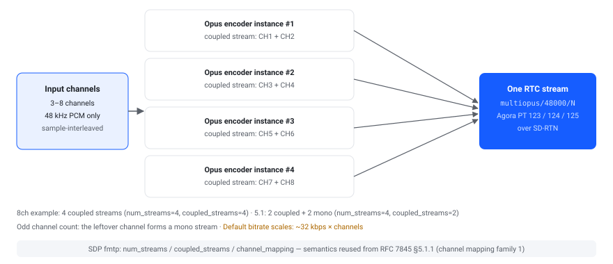
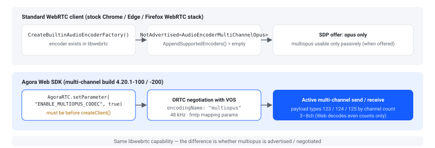
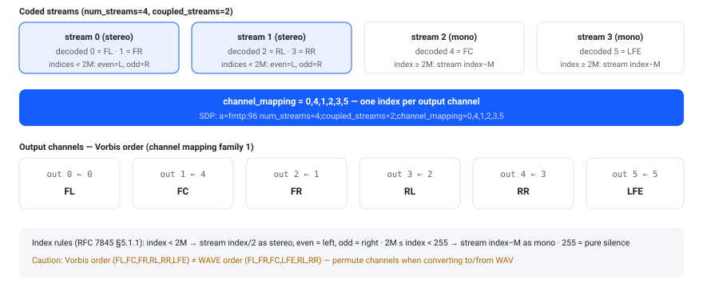
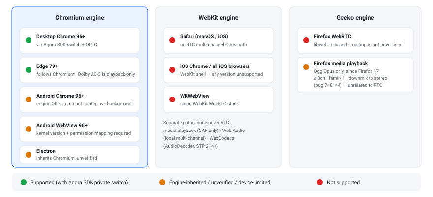

# Chromium / WebRTC Multi-Channel Audio (multiopus) Reference Collection

> Compiled: 2026-10-09 (updated 2026-10-09: Firefox design details, RFC 7845 §5.1.1
> semantics, Chrome flag version timeline, Safari / Edge support status, mobile WebViews
> and mobile browsers, long-term outlook assessment. Reviewed the same day: corrected the
> Firefox WebRTC baseline version, softened the unverified CL date and "8 years" wording,
> attributed the IAMF shipping claim to its third-party source, trimmed the flag quote to
> its verified portion, and made the decoder-instance count statement precise — 7 fixes.)
> Purpose: provides Chromium / WebRTC-side technical background for this repo's Agora
> multi-channel audio (OPUSMC / multiopus) feature — Google libwebrtc's multiopus
> implementation is the underlying mechanism that the Agora Web SDK multi-channel
> capability (`ENABLE_MULTIOPUS_CODEC`, ORTC `encodingName: "multiopus"`) builds on.

---

## 1. Overview: what is multiopus

- **multiopus** is a **non-standardized** Opus multistream (multi-channel) RTP/SDP
  framing convention developed by Google for libwebrtc. RFC 7587 (Opus over RTP)
  standardizes only mono/stereo signaling; the multi-channel part is implemented by
  libwebrtc using the private SDP encoding name `multiopus` plus fmtp parameters
  (`num_streams` / `coupled_streams` / `channel_mapping`), reusing the channel-mapping
  semantics of channel mapping family 1 from RFC 7845 (Ogg Opus encapsulation).
- Encoding principle: every two channels are encoded by one Opus encoder instance as a
  coupled stream; with an odd channel count the leftover channel forms its own mono
  stream. For example, 5.1 (6 channels) = 2 coupled + 2 mono = `num_streams=4`.
- How the GStreamer documentation positions multiopus
  ([rtpopuspay](https://gstreamer.freedesktop.org/documentation/rtp/rtpopuspay.html)):

  > the element supports multichannel Opus audio streams using a non-standardized
  > SDP config and "MULTIOPUS" codec developed by Google for libwebrtc.



*Figure: multiopus multistream encoding — every two channels are encoded by one Opus encoder instance as one coupled stream (8-channel example).*

---

## 2. WebRTC official feature tracking

### 2.1 Main issue: Multi-channel audio support in WebRTC

- Current URL: <https://issues.webrtc.org/issues/42233792>
- Old URL (bugs.chromium.org era): <https://bugs.chromium.org/p/webrtc/issues/detail?id=8649>
- Content: tracks surround/multi-channel audio streaming support in WebRTC based on
  Opus; mentions `WebRtcOpus_GetSurroundParameters` as the configuration convention
  that derives multistream parameters from the channel count.
- The issue was filed in 2017-12 and received its current ID when the WebRTC bug
  database migrated in 2024; it persists as the long-standing feature tracker (see
  Section 7 for what that implies about long-term commitment).

### 2.2 Key CL: Opus multistream mapping

- <https://webrtc-review.googlesource.com/c/src/+/129768>
- This is the landmark CL that introduced the multiopus SDP mapping into libwebrtc,
  cited by both the GStreamer documentation and the IETF draft as the normative source
  of "libwebrtc's Opus multistream mapping".

### 2.3 Related issue: OPUS stereo audio over RTP is muxed to mono

- <https://issues.webrtc.org/issues/41481053>
- Discusses multi-channel capture audio being downmixed; a comment points out that the
  Chrome flag `WebRTC multi-channel capture audio processing` achieves the
  no-downmix behavior, and notes that this behavior later became the default. The CL
  quoted in the thread references `Bug: 1194142, webrtc:8133`.

---

## 3. Key WebRTC source code (with commentary)

All source below comes from the official WebRTC repository
(`chromium.googlesource.com/external/webrtc`, mirror `github.com/webrtc-mirror/webrtc`,
master branch).

### 3.1 Encoder configuration: `AudioEncoderMultiChannelOpusConfig`

File: [api/audio_codecs/opus/audio_encoder_multi_channel_opus_config.h](https://chromium.googlesource.com/external/webrtc/+/HEAD/api/audio_codecs/opus/audio_encoder_multi_channel_opus_config.h)

```cpp
struct RTC_EXPORT AudioEncoderMultiChannelOpusConfig {
  static constexpr int kDefaultFrameSizeMs = 20;
  static constexpr int kDefaultComplexity = 9;
  static constexpr int kMinBitrateBps = 6000;
  static constexpr int kMaxBitrateBps = 510000;

  int frame_size_ms = kDefaultFrameSizeMs;
  size_t num_channels = 1;
  int bitrate_bps = 32000;
  bool fec_enabled = false;
  bool cbr_enabled = false;
  bool dtx_enabled = false;
  int max_playback_rate_hz = 48000;

  // Number of mono/stereo Opus streams.
  int num_streams = -1;

  // Number of channel pairs coupled together, see RFC 7845 section
  // 5.1.1. Has to be less than the number of streams
  int coupled_streams = -1;

  // Channel mapping table, defines the mapping from encoded streams to input
  // channels. See RFC 7845 section 5.1.1.
  std::vector<unsigned char> channel_mapping;
};
```

Key points of the validation logic (`IsOk()` in
`audio_encoder_multi_channel_opus_config.cc`):

- `num_streams >= coupled_streams`; `channel_mapping.size() == num_channels`;
- total coded channels = `num_streams + coupled_streams` (a mono stream codes one
  channel, a coupled stream codes two);
- every `channel_mapping` value must be < the total coded channel count;
  **255 is a special value meaning "ignore this input channel"**;
- coded channels and input channels must correspond one-to-one (inverse-mapping
  check); two input channels may not map to the same coded channel.

### 3.2 SDP parsing and encoder parameters: `SdpToConfig`

File: [modules/audio_coding/codecs/opus/audio_encoder_multi_channel_opus_impl.cc](https://chromium.googlesource.com/external/webrtc/+/HEAD/modules/audio_coding/codecs/opus/audio_encoder_multi_channel_opus_impl.cc)

Key logic:

```cpp
std::optional<AudioEncoderMultiChannelOpusConfig>
AudioEncoderMultiChannelOpusImpl::SdpToConfig(const SdpAudioFormat& format) {
  if (!absl::EqualsIgnoreCase(format.name, "multiopus") ||
      format.clockrate_hz != 48000) {
    return std::nullopt;
  }
  ...
  // All three fmtp parameters are mandatory; the format is rejected otherwise:
  auto num_streams = GetFormatParameter<int>(format, "num_streams");
  if (!num_streams.has_value()) return std::nullopt;
  auto coupled_streams = GetFormatParameter<int>(format, "coupled_streams");
  if (!coupled_streams.has_value()) return std::nullopt;
  auto channel_mapping =
      GetFormatParameter<std::vector<unsigned char>>(format, "channel_mapping");
  if (!channel_mapping.has_value()) return std::nullopt;
  ...
}
```

Commentary:

- **The codec name must be `multiopus` and the clock rate is fixed at 48000 Hz**
  (multi-channel only supports 48 kHz);
- fmtp also recognizes the regular Opus parameters `useinbandfec` / `usedtx` / `cbr` /
  `maxaveragebitrate` / `ptime` / `maxplaybackrate`;
- **the default bitrate scales linearly with the channel count** (comment in the same
  file): 32 kbps per channel for FB (`kOpusBitrateFbBps = 32000`) × channels — this
  explains why a multi-channel stream has a much higher bitrate than plain Opus
  (consistent with this repo's Linux SDK doc: "multi-channel bitrate is high, watch CC
  under weak networks");
- when the channel count > 1, the application mode is automatically set to `kAudio`
  (i.e. OPUS_APPLICATION_AUDIO);
- the actual encoder is created via
  `WebRtcOpus_MultistreamEncoderCreate(num_channels, app, num_streams,
  coupled_streams, channel_mapping)`.

### 3.3 Decoder configuration validation: `AudioDecoderMultiChannelOpusConfig`

File: [api/audio_codecs/opus/audio_decoder_multi_channel_opus_config.h](https://chromium.googlesource.com/external/webrtc/+/HEAD/api/audio_codecs/opus/audio_decoder_multi_channel_opus_config.h)

Same shape as the encoder side; the only difference is the semantics of 255:
**on the decoder side, 255 means "fill this output channel with silence"**
("tells Opus to put silence in output channel x").

### 3.4 The builtin factory does not "advertise" it: `NotAdvertised<AudioEncoderMultiChannelOpus>`

File: [api/audio_codecs/builtin_audio_encoder_factory.cc](https://chromium.googlesource.com/external/webrtc/+/HEAD/api/audio_codecs/builtin_audio_encoder_factory.cc)

```cpp
scoped_refptr<AudioEncoderFactory> CreateBuiltinAudioEncoderFactory() {
  return CreateAudioEncoderFactory<
#if WEBRTC_USE_BUILTIN_OPUS
      AudioEncoderOpus, NotAdvertised<AudioEncoderMultiChannelOpus>,
#endif
      AudioEncoderG722, AudioEncoderG711, NotAdvertised<AudioEncoderL16>>();
}
```

**Key point**: a standard WebRTC client (Chrome) does **not advertise** multiopus in
its SDP offer by default — the encoder exists but is wrapped in `NotAdvertised`
(whose `AppendSupportedEncoders` is an empty implementation), so it can only be used
passively when the remote end offers multiopus.

> Terminology note: "advertise" is the standard SDP/WebRTC term — it refers to an
> endpoint **declaring the codecs it supports** in the `m=` lines of its SDP offer.
> The corresponding source implementation is `AppendSupportedEncoders()`: appending a
> codec to the to-be-advertised list.

This explains why the Agora Web SDK needs the private switch `ENABLE_MULTIOPUS_CODEC`
to actively negotiate multiopus. (The decoder factory
`builtin_audio_decoder_factory.cc` is analogous.)



*Figure: same libwebrtc capability — the difference is whether multiopus is advertised/negotiated. Above: stock WebRTC (answer-only). Below: Agora Web SDK (active, PT 123/124/125).*

### 3.5 Other relevant source locations

- [api/audio_codecs/audio_encoder.h](https://chromium.googlesource.com/external/webrtc/trunk/webrtc/+/f54860e9ef0b68e182a01edc994626d21961bc4b/api/audio_codecs/audio_encoder.h):
  comment `Multi-channel audio must be sample-interleaved.` (multi-channel PCM must be
  sample-interleaved — consistent with the 8-channel interleaved layout requirement in
  this repo's Linux integration guide);
- unit test `modules/audio_coding/codecs/opus/audio_decoder_multi_channel_opus_unittest.cc`
  (cases like `AudioDecoderMultiOpusTest.InvalidChannelMappings` demonstrate how
  invalid mappings are rejected).

---

## 4. SDP signaling format and RFC 7845 channel-mapping semantics

### 4.1 SDP shape

5.1 / 6-channel example:

```sdp
a=rtpmap:96 multiopus/48000/6
a=fmtp:96 num_streams=4;coupled_streams=2;channel_mapping=0,4,1,2,3,5
```

7.1 / 8-channel example:

```sdp
a=rtpmap:111 multiopus/48000/8
a=fmtp:111 num_streams=5;coupled_streams=3;channel_mapping=0,6,1,2,3,4,5,7
```

| Field | Meaning |
| --- | --- |
| `multiopus/48000/<N>` | encoding name / fixed 48 kHz clock / total channel count |
| `num_streams` | total number of Opus streams (mono + stereo streams) |
| `coupled_streams` | how many of them are stereo (coupled) streams |
| `channel_mapping` | comma-separated mapping table; semantics per RFC 7845 §5.1.1 |

### 4.2 RFC 7845 §5.1.1 Channel Mapping semantics in detail

[RFC 7845 §5.1.1](https://datatracker.ietf.org/doc/html/rfc7845#section-5.1.1) (the
channel mapping of Ogg Opus encapsulation — multiopus's three fmtp parameters map
one-to-one onto the three fields defined here) defines three quantities:

- **N = Stream Count**: the number of Opus streams coded in each packet; must not be 0;
- **M = Coupled Stream Count**: the decoders for the first M streams are initialized
  for **stereo** (two-channel) output, the remaining N−M for **mono**; `M ≤ N`;
- **C = Channel Count (output channels)**: the mapping table provides one 8-bit index
  per output channel (C bytes in total).

The total number of decoded channels is **M+N** (the first M streams each decode to 2
channels, the remaining N−M to 1 channel each) and must be ≤ 255. Note that C is not
required to equal M+N: the same decoded channel may be mapped to multiple output
channels, and some decoded channels may not be assigned to any output channel.

**Mapping-table index semantics** (let `index` be the octet for a given output
channel):

| `index` value | Meaning |
| --- | --- |
| `index < 2*M` | decode stream `index/2` as stereo and take the **left channel if `index` is even, right if odd** |
| `2*M ≤ index < 255` | decode stream `index − M` as mono |
| `index = 255` | the output channel **MUST contain pure silence** |

**Channel Mapping Family** (one octet in the ID header; determines the semantic
meaning/placement of the output channels):

| Family | Channels | Semantics |
| --- | --- | --- |
| 0 | 1 or 2 | RTP mapping, same as RFC 7587 (mono / L,R stereo); the mapping table **MUST be omitted**; defaults N=1, M=C−1, index=0,1 |
| 1 | 1…8 | **Vorbis channel order** surround placement (table below) |
| 255 | 1…255 | channels have no defined meaning; general-purpose players SHOULD NOT play these; offline tools MAY deinterleave to one PCM per channel |
| 2…254 | — | reserved; demuxers SHOULD treat them as 255 |

**Family 1 standard placements (Vorbis order)**:

| Channels | Layout | Channel order |
| --- | --- | --- |
| 1 | mono | mono |
| 2 | stereo | L, R |
| 3 | linear surround | L, C, R |
| 4 | quadraphonic | FL, FR, RL, RR |
| 5 | 5.0 | FL, FC, FR, RL, RR |
| 6 | **5.1** | **FL, FC, FR, RL, RR, LFE** |
| 7 | 6.1 | FL, FC, FR, SL, SR, RC, LFE |
| 8 | **7.1** | **FL, FC, FR, SL, SR, RL, RR, LFE** |

Important reminders (explicit in the RFC text):

- **Vorbis order differs from the channel order used by WAVE/FLAC**, so converting to
  or from those formats requires permuting the output channels. For example, 5.1 in
  WAVE is FL, FR, FC, LFE, RL, RR, while Vorbis order is FL, FC, FR, RL, RR, LFE —
  the center and LFE positions are entirely different;
- "LFE" refers to a Low Frequency Effects channel (typically a subwoofer, with no
  particular spatial position);
- §5.1.1.5 requires that **players MUST support any valid family 0/1 mapping** (even
  when the channel count does not match a known layout), and provides standard
  multichannel→stereo downmix matrices (players SHOULD implement them).

**Correspondence with multiopus**: libwebrtc carries the three fields from the Ogg ID
header (N / M / mapping table) verbatim into the SDP fmtp parameters (`num_streams` /
`coupled_streams` / `channel_mapping`), with the family implicitly being family 1
(surround semantics). For example, the 5.1 mapping `channel_mapping=0,4,1,2,3,5`: the
decoded channel sequence is stream0 stereo pair (0,1), stream1 stereo pair (2,3),
stream2 mono (4), stream3 mono (5) — i.e. FL,FR,RL,RR,FC,LFE; the mapping table
0,4,1,2,3,5 reorders that into the Vorbis output order FL,FC,FR,RL,RR,LFE.



*Figure: RFC 7845 §5.1.1 walkthrough — the 5.1 mapping table reorders the decoded channel sequence into Vorbis output order.*

---

## 5. Chrome browser side: the multi-channel capture flag

Chrome offered an experimental flag (`chrome://flags`):

- Flag name: `#enable-webrtc-capture-multi-channel-audio-processing`
- Title: **WebRTC multi-channel capture audio processing**
- Description
  ([flag_descriptions.cc](https://chromium.googlesource.com/chromium/src/+/1d795bfe6fc5245d292042b5158649b5d232d4fa/chrome/browser/flag_descriptions.cc)):

  > Support in WebRTC for processing capture audio in multi channel without
  > downmixing when running APM in the render process.

**Version timeline** (based on verifiable evidence):

| Milestone | Evidence |
| --- | --- |
| The flag existed **no later than Chrome 85** (stable 2020-08) | A [chrome://flags listing captured on 2020-10-06 from Chrome 85.0.4183.83](https://gist.github.com/bbaudry/634f1b6107440715d0b45020a0545e62) already contains it |
| Still being iterated around 2021 | The CL quoted in webrtc issue [41481053](https://issues.webrtc.org/issues/41481053) references `Bug: 1194142, webrtc:8133` (crbug 1194142 belongs to the M90/M91-era bug number range in 2021) |
| **Expired and removed in M123 (2024-03)**, behavior became default | `expiry_milestone: 123` in [flag-metadata.json](https://chromium.googlesource.com/chromium/src/+/5e93f02fe938d402228a5428cea87963d51b0ed0/chrome/browser/flag-metadata.json) (owner: saza); Chromium auto-generated "Flag expired in M123" cleanup issues at that time; the 41481053 thread confirms no-downmix became the default behavior |

Do not confuse these two similar flags:

- `enable-webrtc-capture-multi-channel-audio-processing` (this section: multi-channel
  capture into APM without downmixing);
- `enable-webrtc-apm-downmix-capture-audio-method` (a separate APM downmix-method
  switch, also expired in M123 — see [issue 41493988](https://issues.chromium.org/issues/41493988)).

Also note: **this flag governs "multi-channel capture audio entering APM without
downmixing"** — a different stage from the multiopus codec. In the Agora Web SDK
multi-channel scenario, microphone capture remains an ordinary use case; multiopus
mainly applies to custom-track/file publishing and to the subscribing decode side.

---

## 6. Standardization activity: IETF draft-shin-avtcore-rtp-multi-opus

- Document: <https://datatracker.ietf.org/doc/draft-shin-avtcore-rtp-multi-opus/>
  (latest version: [draft-shin-avtcore-rtp-multi-opus-03](https://datatracker.ietf.org/doc/draft-shin-avtcore-rtp-multi-opus/03/))
- Author: Sun Shin (NVIDIA); first published 2025-10; **latest revision -03
  (2026-04-16, expiring 2026-10-18)**; an individual submission with intended status
  Informational, **not adopted by the AVTCORE working group** — it does not constitute
  a standard.
- Core content: formalizes the already-deployed `multiopus` private SDP convention
  from libwebrtc — defines `a=rtpmap:<pt> multiopus/48000/<channel-count>` and the
  three fmtp parameters, specifies Offer/Answer procedures (an offer SHOULD also carry
  `opus/48000/2` as a stereo fallback; an answerer that does not support multiopus
  must not silently downgrade to stereo), and explicitly cites webrtc-review CL 129768
  as the source of libwebrtc's mapping semantics.
- **New in -03** (worth tracking):
  - §6.1.3 *Mapping Families and Extensibility*: normatively specifies mapping family
    1 (channel-based speaker layouts) and states the signaling is extensible to other
    families (e.g. Ambisonics) without changes to the RTP payload format; an endpoint
    that receives an offer with an unsupported mapping family MUST reject that payload
    type during Offer/Answer;
  - §6.1.5 *Field Presence and Constraints*: `channel_mapping` is **REQUIRED** for
    more than two output channels; it MAY be omitted for a single-stream mono/stereo
    configuration (then interpreted as RFC 7845 family 0 semantics); all values are
    integers in 0..255; mapping family 1 must not exceed 8 output channels.
  - The introduction notes that the **MLCODEC Working Group is defining extensions to
    the Opus codec**, and future extensions may reuse this SDP signaling framework.
- Relationship to RFCs (from the draft): RFC 6716 (Opus codec) and RFC 7845 (Ogg
  channel mapping) define the mapping semantics but no SDP signaling; RFC 7587 defines
  SDP signaling for mono/stereo only; this draft fills the multi-channel RTP/SDP
  signaling gap.

---

## 7. Assessing Chrome/Chromium's long-term plans and commitment

Bottom line: **Chrome/Chromium has made no public long-term commitment to
multi-channel audio for RTC (multiopus)**; it is a libwebrtc in-tree capability that
is "stable but not advertised by default". Splitting "multi-channel audio" into four
tracks, the commitment signals differ in strength:

### 7.1 multiopus (RTC transport codec): no formal commitment, but de facto stable

- The capability has been maintained in-tree for years (the multi-channel codec sources
  carry a 2019 copyright, and an April 2020 node-webrtc issue shows third parties already
  interoperating with it; the exact landing date of CL 129768 was not individually
  verified): encoder/decoder, config validation, and unit tests all present; the GStreamer
  and Janus ecosystems interop against this convention — **the risk of removal is low**.
- But Google has never committed to exposing it by default: the `NotAdvertised`
  wrapper has been unchanged for years, and no multiopus entry was found on
  ChromeStatus (no origin trial / shipping plan seen).
- The feature-tracking issue (filed 2017-12, now
  <https://issues.webrtc.org/issues/42233792>) has existed for years — the demand is
  recorded, but no scheduling commitment is visible.
- Implication for this repo: Agora's "private switch + own ORTC negotiation" route is
  decoupled from Chrome's defaults and is a sound way to depend on the capability;
  do not assume Chrome will ever advertise multiopus by default.

### 7.2 Standardization: the IETF draft keeps evolving (industry signal, not a Google commitment)

- draft-shin-avtcore-rtp-multi-opus has been continuously revised from -00 (2025-10)
  to -03 (2026-04), showing that parts of the industry (led by NVIDIA) are pushing
  standardization; but it has not been adopted by the working group, and Google/Chrome
  has not publicly endorsed it.
- If it is ever adopted as an AVTCORE WG document, the interop outlook would improve
  significantly — worth tracking (see Section 6 for what -03 added).

### 7.3 Capture path: "graduated", the strongest commitment signal

- Multi-channel capture into APM without downmixing moved from an experimental flag to
  default behavior (flag expired in M123 / 2024-03) — a feature graduating to default
  is Google's clearest form of long-term commitment to capture-side multi-channel.

### 7.4 Playback / spatial audio: Google's investment is in IAMF/Eclipsa, not RTC

- In 2025-01 Google announced that **Eclipsa Audio (based on AOM's IAMF, a
  royalty-free spatial audio format co-developed with Samsung) will be supported in
  Chrome and Android** ([9to5Google](https://9to5google.com/2025/01/19/eclipsa-audio-google-chrome-android/)).
- In 2026-08, Chrome 152 stable shipped IAMF decoding (MSE path, Opus in MP4
  containers — per third-party reporting, not individually verified against official
  Chrome channels).
- This shows Google's multi-channel/spatial audio investment is on the **media
  playback / streaming** track (the YouTube scenario) — a parallel track to RTC
  multi-channel; it neither conflicts with nor directly reinforces multiopus.

### 7.5 Overall assessment

| Sub-capability | Commitment strength | Evidence |
| --- | --- | --- |
| multiopus RTC codec | No formal commitment; de facto stable (maintenance mode) | in-tree for years (≥2019), tests present, ecosystem interop; no ChromeStatus entry found; not advertised by default |
| Multi-channel capture (APM) | Strong (now default) | flag graduated in M123 |
| Standardization (RTP/SDP signaling) | Medium (industry-driven, in progress) | IETF draft -00→-03, not WG-adopted |
| Spatial / multi-channel media playback | Strong (a different track) | Eclipsa/IAMF announcement + Chrome 152 shipping |

Recommendation: in this repo's documentation and in customer-facing statements,
describe multiopus as "a private enablement of an existing libwebrtc capability" and
avoid implying official Chrome support; keep tracking draft-shin-avtcore-rtp-multi-opus
(if WG-adopted, the interop outlook improves significantly) and MLCODEC's Opus
extension work.

---

## 8. Firefox's multi-channel design and implementation (Mozilla deep dive)

Firefox's multi-channel Opus support lives on the **Ogg container + `<audio>`/`<video>`
element** path — entirely different from Chrome's WebRTC/multiopus path. The core
implementation is documented in
[bug 748144](https://bugzilla.mozilla.org/show_bug.cgi?id=748144)
("Opus codec in `<audio>` and `<video>` should support multichannel audio",
RESOLVED FIXED, **target milestone: mozilla17, i.e. Firefox 17, released 2012-11**;
contributor Alexandros Chronopoulos [:achronop], mentor: Ralph Giles [:rillian]).

### 8.1 Design points (from the bug 748144 discussion)

1. **Parse the channel mapping table from OpusHead**: `nsOpusState::DecodeHeader`
   reads the channel mapping family (byte 18), stream count N (19), coupled count M
   (20), and the mapping table (C bytes starting at 21); family 0 uses defaults
   (N=1, M=C−1, mapping 0,1). A family 1 header must be 19+C bytes, and every read
   must be bounds-checked first.
2. **Switch to the multistream decode API**: `opus_decode*` →
   `opus_multistream_decoder_create()` + `opus_multistream_decode[_float]()`; the three
   extra arguments are exactly N / M / the mapping table. The number of samples per
   packet is computed as
   `opus_packet_get_nb_frames × opus_packet_get_samples_per_frame` (valid for
   multistream packets too — individual streams may use different frame sizes, but the
   product of the two is the same for all streams, which is validated at decode time).
3. **Only family 1 is supported**: family 0 is the pre-existing mono/stereo case;
   "the higher families don't have a defined speaker assignment for each channel, so
   they're only useful for specialist audio applications like multitrack mixers"
   (rillian).
4. **>2 channels are downmixed to stereo**: Firefox's audio library only supported
   mono/stereo playback at the time, so downmix matrices were borrowed from
   **opus-tools** (`setup_downmix` / `read_downmix` in `audio_in.c`), with per-row
   normalization to 2 (for 5–8 channels); the review thread debates "normalize vs clip
   vs compressor" in detail.
5. **>8 channels are refused outright**: "For > 8 channels we don't have a channel
   mapping, so I think we should just refuse to play such opus streams for now."
   (consistent with RFC 7845 family 1's 1…8 channel limit)
6. **Fixed-point downmixing was deferred**: the initial version only supported the
   float-sample path (multi-channel returns `NS_ERROR_FAILURE` when
   `MOZ_SAMPLE_TYPE_FLOAT` is not defined); the fixed-point version was followed up in
   [bug 790458](https://bugzilla.mozilla.org/show_bug.cgi?id=790458).
7. **A defensive-programming example**: `mChannels < 1` must be rejected early — at
   the time, `opus_multistream_decoder_create` with invalid arguments would compute a
   zero-size allocation and then segfault/scribble on the heap (fixed later in
   upstream libopus).
8. Engineering details: a link error traced to `opus_multistream.h` missing
   `extern "C"` guards (worked around with `extern "C" { #include ... }` until the
   upstream fix); new symbols had to be added to `layout/media/symbols.def.in`.

### 8.2 Architectural differences vs Chrome/multiopus

| Dimension | Firefox (bug 748144 route) | Chrome / libwebrtc (multiopus) |
| --- | --- | --- |
| Carrier | Ogg container files, `<audio>`/`<video>` playback | RTP real-time transport, PeerConnection |
| Signaling | Ogg ID header (family + N + M + mapping table) | SDP `multiopus` + three fmtp parameters |
| Channel semantics | Strictly RFC 7845 family 1 (Vorbis placement) | Same mapping semantics, but carried in SDP |
| Beyond playback capability | In-browser downmix matrix → stereo | No built-in downmix obligation; behavior is up to the app/endpoint |
| Channel limit | 8 (>8 refused) | Whatever the SDP declares (encoder side ≤ `kMaxNumberOfChannels`) |

Note: Firefox's **WebRTC** stack is likewise built on libwebrtc (and has been since WebRTC
was enabled by default in Firefox 22, 2013), so it is
subject to the same `NotAdvertised<AudioEncoderMultiChannelOpus>` limitation — it will
not actively advertise multiopus in SDP either. Its multi-channel capability lives on
the media-file playback path, a different line from this repo's RTC scenario.

---

## 9. Safari's multi-channel audio support

Bottom line: **Safari has no multiopus equivalent**. Its multi-channel support is
scattered across three unrelated paths — media playback, Web Audio, and WebCodecs —
and none of them covers "multi-channel Opus inside an RTC stream".

### 9.1 Media element playback (`<audio>`/`<video>`)

- Opus: accepted **only in a CAF container**, and only since macOS High Sierra (10.13)
  / iOS 11 ([MDN Web audio codec guide](https://developer.mozilla.org/en-US/docs/Web/Media/Guides/Formats/Audio_codecs)).
  The CAF path decodes through the CoreAudio system decoder; whether a multi-channel
  CAF Opus file comes out channel-by-channel depends on the system and hardware.
- WebM/Opus: partially supported since macOS Safari 14.1, **still not supported on
  iOS** ([WebKit bug 238546](https://bugs.webkit.org/show_bug.cgi?id=238546),
  confirmed as of 2024-03: "no support for WebM Opus on iOS").
- Ogg container: not supported by Safari at all, so Firefox's Ogg multi-channel route
  does not exist on Safari.

### 9.2 Web Audio API (multi-channel output/processing)

- Safari (WebKit) has supported Web Audio multi-channel capability for a long time:
  `AudioContext.destination.channelCount` is settable up to `maxChannelCount`
  (device-dependent); `ChannelSplitterNode` / `ChannelMergerNode` split/merge channels
  (available since the Safari 6 webkit-prefix era).
- Normative basis: the W3C [Web Audio API](https://www.w3.org/TR/webaudio/) —
  `channelCount` / `channelCountMode` (`max`/`clamped-max`/`explicit`) and
  `channelInterpretation` (`speakers` for placement-based up/down-mixing, `discrete`
  for channel-by-channel passthrough).
- This is "local multi-channel processing/output" and involves no RTP transport.

### 9.3 WebCodecs

- WebKit enabled `WebCodecs AudioDecoder` by default starting with
  [Safari Technology Preview 214 (2025)](https://developer.apple.com/documentation/safari-technology-preview-release-notes/stp-release-214).
  This opens the door to "your own decode pipeline for multi-channel audio", but there
  is no official specification of Safari's Opus multi-channel decode surface (channel
  count limits, mapping-table semantics).

### 9.4 WebRTC

- Safari's WebRTC builds on WebKit's own libwebrtc-derived stack and **does not expose
  multiopus negotiation**; no Opus multi-channel RTP beyond RFC 7587 has been adopted
  by Safari (the only standardization attempt is the individual IETF draft in
  Section 6 above).
- Consistent with this repo's capability boundary: the Agora docs explicitly mark
  Safari / Firefox as unsupported for multi-channel channels (behavior undefined on
  join — possibly silence or stereo only).

---

## 10. Microsoft Edge: WebRTC follows Chromium, media playback has extras

### 10.1 WebRTC / multiopus: follows Chromium

- Since **Edge 79** (2020-01, the first Chromium-based stable release), Edge's WebRTC
  stack is libwebrtc, with version numbers mapping one-to-one to Chromium
  (Edge 96 ≈ Chromium 96). Third-party compatibility assessments call Chromium-based
  Edge "functionally equivalent to Chrome in terms of WebRTC implementation"
  ([Ant Media](https://antmedia.io/webrtc-browser-support/)).
- Therefore the key multiopus behaviors match Chrome: the builtin encoder exists but
  is wrapped in `NotAdvertised`, is not advertised in SDP by default, is fixed at
  48 kHz, and uses the three fmtp parameters. The Agora Web SDK's
  `ENABLE_MULTIOPUS_CODEC` + ORTC negotiation is expected to behave the same on Edge
  as on Chrome (by version mapping, "Chrome 96+" ≙ "Edge 96+"; if official
  documentation names only Chrome, verify on Edge before promising it to customers).
- No known Edge deviation from Chromium on the WebRTC **audio/Opus** side. The known
  deviation case is on the video side: Edge does not publish H.265/HEVC over WebRTC
  even on HEVC-capable hardware ([Microsoft Learn Q&A](https://learn.microsoft.com/en-gb/answers/questions/5880331/h-265-hevc-not-published-sent-via-webrtc-chrome-su))
  — showing that Edge does trim the WebRTC codec surface when it chooses to, but
  there is no evidence it has touched Opus/multiopus.

### 10.2 Where Edge is special (multi-channel audio related, but not WebRTC)

- **Dolby Audio (AC-3 / E-AC-3)**: Edge supports Dolby Digital / Dolby Digital Plus
  (5.1/7.1 surround) media playback through the Windows platform decoders (Media
  Foundation), combinable with PlayReady DRM (MSE/EME path; see the official Microsoft
  blog post
  [Announcing Dolby Audio for high performance audio in Microsoft Edge](https://blogs.windows.com/msedgedev/2015/05/26/announcing-dolby-audio-for-high-performance-audio-in-microsoft-edge/)).
  AC-3/EC-3 are Dolby intellectual property and are not integrated into Chromium
  itself (the community even maintains a project that patches Chromium for AC-3/EC-3
  system decoding: [cjw1115/enable-chromium-ac3-ec3-system-decoding](https://github.com/cjw1115/enable-chromium-ac3-ec3-system-decoding)).
  This is a real Edge-vs-Chrome difference for "multi-channel audio playback" — but
  it is a media-playback/DRM path, unrelated to WebRTC.
- **Windows 11 24H2 no longer ships the AC-3 codec in the OS** ([official Microsoft
  support document](https://support.microsoft.com/en-us/windows/apps/windowsmediaplayer/troubleshoot-windows-media-player-errors):
  "Beginning with Windows 11, version 24H2, the AC-3 codec is no longer included with
  Windows. However, many device manufacturers will pre-install an AC-3 codec.") —
  AC-3 playback that relies on the system decoder may regress on 24H2 (except on
  devices with an OEM pre-installed decoder).
- Edge on macOS gets no Windows platform codec bonus and behaves closer to Chrome.

---

## 11. Mobile WebViews (Android / iOS)

### 11.1 Android WebView: the engine follows Chromium, with three caveats

- **Engine and versioning**: WebView has been Chromium-based since Android 4.4;
  Android System WebView has been independently updatable via Google Play since
  Android 5.0; and since Android 7.0, Chrome itself can serve as the WebView
  implementation. WebView version numbers map to Chromium (WebView 96 ≈ Chromium 96),
  so **multiopus capability in principle follows Chromium**: `NotAdvertised`, fixed
  48 kHz, the three fmtp parameters — and the Agora Web SDK's
  `ENABLE_MULTIOPUS_CODEC` + ORTC negotiation is expected to work.
- **Caveat 1: permissions must be brokered by the native layer**. WebRTC's
  getUserMedia permission is surfaced by the WebView to the app via
  `WebChromeClient.onPermissionRequest`; the app must map
  `android.webkit.resource.AUDIO_CAPTURE` / `VIDEO_CAPTURE` to `RECORD_AUDIO` /
  `CAMERA` and explicitly call `grant()` (see the official Android
  [PermissionRequest documentation](https://developer.android.com/reference/android/webkit/PermissionRequest)).
  A missing mapping produces the asymmetric failure "camera works, microphone denied"
  (this repo's `agora-webrtc-webview-permissions` skill has a full checklist and a
  real-world RCA).
- **Caveat 2: engine fragmentation**. Third-party or app-bundled WebView kernels
  (Tencent X5; Meta's [own Chromium WebView bundled inside the Facebook app](https://engineering.fb.com/2022/09/30/android/launching-a-new-chromium-based-webview-for-android/),
  etc.) may not match the system WebView version — capability is determined by the
  actual kernel version.
- **Caveat 3: the output side usually has no multi-channel**. Phone/tablet audio
  output is overwhelmingly stereo, and the Android audio framework downmixes to the
  device's capability; multi-channel output generally exists only on specific
  peripherals (HDMI, USB audio). "Being able to decode multi-channel PCM" and "being
  able to play it out in multi-channel" are different things — verification scenarios
  (per-channel volume bars, selectChannels listening) are unaffected, but the
  multi-channel speaker experience is device-limited.

### 11.2 iOS WebView (WKWebView): no multiopus path at all

- **Every iOS browser is a WebKit shell** (App Store policy): Chrome / Firefox / Edge
  on iOS share the same WebKit WebRTC stack as WKWebView. The Section 9 conclusions
  for Safari therefore apply verbatim to all WebViews and browsers on iOS —
  **multiopus support does not exist on iOS**.
- WebRTC availability timeline:
  - iOS 11 (2017): WebRTC only inside the Safari app itself — not in WKWebView, not
    even in SFSafariViewController;
  - iOS 13: SFSafariViewController gained getUserMedia
    ([WebKit bug 183201](https://bugs.webkit.org/show_bug.cgi?id=183201));
  - iOS 14.3 (2020-12): **WKWebView gained getUserMedia / WebRTC**
    ([WWDC21 Session 10032](https://developer.apple.com/videos/play/wwdc2021/10032/));
    third-party SDKs (e.g. [Twilio](https://www.twilio.com/docs/video/javascript))
    announced iOS WebView support (iOS 14.3+) from then on.
- Other constraints: the camera is disabled when the app goes to background, and
  keeping the microphone alive in background needs extra configuration; the missing
  RTC multi-channel Opus specification on Safari applies identically to WKWebView.

### 11.3 Implications for this repo's verification scenarios

- To verify multi-channel on mobile, **an Android in-app WebView (kernel 96+) is the
  only viable Web path**, provided the app implements the permission mapping
  correctly; on iOS, direct users to desktop Chrome or switch to the Native SDK.
- If a customer reports "multi-channel silence / cannot join the channel" inside an
  Android WebView, troubleshoot the plain WebRTC chain first (permission mapping,
  kernel version), then the multiopus negotiation — do not misread a WebView
  permission issue as a multi-channel capability issue.

---

## 12. Mobile browsers: Android Chrome and iOS Chrome

### 12.1 Android Chrome: capability follows desktop Chrome; the limits are all on the device/OS side

- **Engine**: Android Chrome is full Chromium (same source, same version as desktop);
  the multiopus-related behaviors (`NotAdvertised`, fixed 48 kHz, the three fmtp
  parameters, ORTC negotiation) match desktop; `ENABLE_MULTIOPUS_CODEC` is an Agora
  SDK-level switch and is platform-independent.
- **Version requirement**: same as desktop — **Chrome 96+ (110+ recommended)**.
  Android Chrome auto-updates via the Play Store, so real-world versions are far ahead
  and version is rarely the blocker; **no chrome://flags setting is needed** (the
  Section 5 capture-side APM flag became default in M123, and it only affects capture,
  not multiopus codec negotiation).
- **Limits and special considerations**:
  1. **Output is stereo**: phone/tablet speakers and the Android audio framework are
     essentially stereo; decoded multi-channel PCM is downmixed by the system on
     playback. Multi-channel output is only possible via peripherals such as HDMI /
     USB audio. Verification features (`channelCount`, per-channel
     `getVolumeLevels()` bars, `selectChannels` listening) are unaffected — "able to
     decode multi-channel" and "able to play out multi-channel" are different things.
  2. **Autoplay policy**: audio can only start after a user gesture (tap); the
     demo/page must start playback from a click interaction.
  3. **Background tabs and screen-off**: Android Chrome aggressively suspends
     background tabs, and RTC audio stops; keep the tab foregrounded and the screen on
     for long verification sessions.
  4. **CPU / battery / network**: the number of decoder-side Opus instances grows with
     `num_streams` (this repo's 8-channel PT 125 configuration uses 4 coupled streams =
     4 decoder instances) — more CPU and thermal pressure than desktop; the high
     multi-channel bitrate (default ~32 kbps/channel) is more sensitive on cellular
     weak networks.
  5. **Bluetooth routing**: A2DP / SCO are mono/stereo only — no multi-channel output
     over Bluetooth headsets.
- **Official stance**: this repo's spec (`Spec/web_sdk_audio_multichannel_spec.md`
  §8.3) scopes platform support to Web (Chrome 96+) only — mobile is out of scope, so
  "it works on Android Chrome" is an engine-inheritance behavior that has not been
  officially verified and should not be promised to customers.

### 12.2 iOS Chrome: a WebKit shell — unsupported at any version

- **Engine**: under App Store policy, Chrome on iOS is a WKWebView shell (WebKit),
  regardless of its version number — the Section 9 / 11.2 conclusions apply verbatim:
  **no multiopus, and there is no "install version X and it works" story**.
- Basic WebRTC itself works (getUserMedia via WKWebView since iOS 14.3); ordinary Opus
  mono/stereo calls are fine, but multi-channel negotiation never happens.
- The only viable paths on iOS are the Native SDK (this repo's
  `Spec/native_sdk_audio_multichannel_spec.md` marks iOS as "same design lineage,
  theoretically reusable, unverified") or switching to desktop Chrome.

### 12.3 Quick-reference table

| Endpoint | Engine | multiopus | Version requirement | Main limitations |
| --- | --- | --- | --- | --- |
| Android Chrome | Chromium | Expected to work (not officially verified) | Chrome 96+ (110+ recommended) | stereo output downmix, autoplay gesture required, background/screen-off suspension, CPU/battery, Bluetooth is stereo-only |
| Android WebView | Chromium (kernel can be replaced/frozen by the app) | Expected to work (not officially verified) | kernel 96+, and the app implements permission mapping correctly | same as Android Chrome, plus missing permission mappings and engine fragmentation |
| iOS Chrome / any iOS browser | WebKit (WKWebView) | **Not supported** | none (unsupported at any version) | engine does not support it; no Web-side workaround |
| iOS WKWebView | WebKit | **Not supported** | none | same as above |



*Figure: multiopus support landscape by browser engine — supported (green), engine-inherited/unverified/device-limited (amber), not supported (red).*

---

## 13. Ecosystem and practical resources

- **GStreamer rtpopuspay / rtpopusdepay**: for inputs with >2 channels it automatically
  generates multiopus caps/SDP in libwebrtc syntax
  ([documentation](https://gstreamer.freedesktop.org/documentation/rtp/rtpopuspay.html)),
  useful for building third-party multi-channel senders that interop with Chrome.
- **Janus WebRTC Server multiopus demo**: a multi-channel variant of the Echo Test
  demo that plays a pre-recorded surround file in the browser
  ([online demo](https://janus.conf.meetecho.com/demos/multiopus.html)) — usable as an
  independent tool to verify "Chrome receiving/playing multiopus".
- **node-webrtc issue #603** ([Multichannel opus / multiopus](https://github.com/node-webrtc/node-webrtc/issues/603)):
  a developer removed the `NotAdvertised` wrapper via custom encoder/decoder factories
  so the server SDP could proactively offer `multiopus/48000/6` (5.1) and
  `multiopus/48000/8` (7.1) — the same idea as the Agora Web SDK opening multiopus via
  a private parameter.

---

## 14. Relevance to this repository

1. **Terminology**: Chromium/WebRTC consistently use `multi-channel audio` /
   `multichannel audio` (compound adjective; "channel" stays singular); this repo's
   docs already follow that convention.
2. **48 kHz limitation**: multiopus hardcodes 48000 Hz at the SDP layer — the same
   origin as this repo's "multi-channel encoding/decoding only supports 48 kHz"
   capability boundary.
3. **Bitrate**: WebRTC's default bitrate = 32 kbps × channel count (FB), i.e. ~256 kbps
   for 8 channels — explaining why congestion-control tuning matters on weak networks.
4. **Negotiation mechanism**: a standard WebRTC client does not advertise multiopus in
   SDP by default; the Agora Web SDK enables it through the private switch
   `ENABLE_MULTIOPUS_CODEC` plus ORTC negotiation (payload types 123/124/125) —
   a productized wrapper on top of existing libwebrtc capability.
5. **Channel layout semantics**: the `channel_mapping` table follows RFC 7845 §5.1.1
   (see Section 4.2 of this document); this repo's broadcast scenario "4×stereo →
   8-channel interleaved reordering" is an application-level custom layout (4
   independent stereo pairs, not 7.1 surround), semantically different from RFC 7845
   family 1's standard placements (e.g. 7.1's FL,FC,FR,SL,SR,RL,RR,LFE); moreover
   **Vorbis order ≠ WAVE order**, so channel permutation is mandatory when converting
   to/from WAV material — pay special attention when interworking with third-party
   decoders.
6. **Browser/endpoint boundaries**: Chrome can use multiopus via a private switch /
   ORTC; **Edge (Chromium-based, 79+) follows Chrome's WebRTC behavior**, and its
   Dolby AC-3/E-AC-3 extras are confined to the media-playback path; Firefox's
   multi-channel capability lives on the Ogg media playback path (8-channel limit,
   downmix/refusal beyond it) and it likewise does not advertise multiopus on the
   WebRTC side; Safari has no RTC multi-channel Opus path at all. Mobile follows the
   same engine logic: Android Chrome / WebView ≈ Chromium (expected equivalent, not
   officially verified, device-side limits — stereo output, autoplay, background
   suspension); iOS Chrome / WKWebView = WebKit, entirely unsupported. Together they
   corroborate this repo's "Chrome 96+ only" capability statement (anything beyond
   desktop Chrome should be verified empirically before being promised to customers).
7. **Long-term outlook**: multiopus has been maintained in the libwebrtc tree for
   years with low removal risk, but Google has made no formal commitment (not
   advertised by default, no ChromeStatus entry); standardization is progressing in
   the industry (draft -03, not WG-adopted). Externally, describe it as "a private
   enablement of an existing libwebrtc capability", and keep tracking
   draft-shin-avtcore-rtp-multi-opus and MLCODEC's Opus extension work (see
   Section 7).

---

## 15. Reference link list

| Category | Link |
| --- | --- |
| WebRTC main issue | <https://issues.webrtc.org/issues/42233792> |
| Related issue (stereo muxed to mono) | <https://issues.webrtc.org/issues/41481053> |
| multiopus introduction CL | <https://webrtc-review.googlesource.com/c/src/+/129768> |
| Encoder config header | <https://chromium.googlesource.com/external/webrtc/+/HEAD/api/audio_codecs/opus/audio_encoder_multi_channel_opus_config.h> |
| Encoder implementation (SdpToConfig) | <https://chromium.googlesource.com/external/webrtc/+/HEAD/modules/audio_coding/codecs/opus/audio_encoder_multi_channel_opus_impl.cc> |
| Decoder config header | <https://chromium.googlesource.com/external/webrtc/+/HEAD/api/audio_codecs/opus/audio_decoder_multi_channel_opus_config.h> |
| Builtin encoder factory (NotAdvertised) | <https://chromium.googlesource.com/external/webrtc/+/HEAD/api/audio_codecs/builtin_audio_encoder_factory.cc> |
| Chrome flag description | <https://chromium.googlesource.com/chromium/src/+/1d795bfe6fc5245d292042b5158649b5d232d4fa/chrome/browser/flag_descriptions.cc> |
| Chrome flag metadata | <https://chromium.googlesource.com/chromium/src/+/5e93f02fe938d402228a5428cea87963d51b0ed0/chrome/browser/flag-metadata.json> |
| Chrome 85 flags listing (2020-10 snapshot) | <https://gist.github.com/bbaudry/634f1b6107440715d0b45020a0545e62> |
| Similar-flag expiry issue (M123) | <https://issues.chromium.org/issues/41493988> |
| IETF multiopus draft (latest -03) | <https://datatracker.ietf.org/doc/draft-shin-avtcore-rtp-multi-opus/> |
| IETF multiopus draft -03 full text | <https://datatracker.ietf.org/doc/draft-shin-avtcore-rtp-multi-opus/03/> |
| Google announces Eclipsa Audio for Chrome/Android (9to5Google) | <https://9to5google.com/2025/01/19/eclipsa-audio-google-chrome-android/> |
| IAMF decoding shipped in Chrome 152 (analysis) | <https://mintec.co/blog/audio-inmersivo-iamf-chrome-2026/> |
| Firefox multi-channel implementation bug 748144 | <https://bugzilla.mozilla.org/show_bug.cgi?id=748144> |
| Firefox fixed-point downmix follow-up bug 790458 | <https://bugzilla.mozilla.org/show_bug.cgi?id=790458> |
| MDN Web audio codec guide (Safari CAF limitation) | <https://developer.mozilla.org/en-US/docs/Web/Media/Guides/Formats/Audio_codecs> |
| WebKit WebM Opus support bug 238546 | <https://bugs.webkit.org/show_bug.cgi?id=238546> |
| Safari TP 214 (WebCodecs AudioDecoder on by default) | <https://developer.apple.com/documentation/safari-technology-preview-release-notes/stp-release-214> |
| Edge WebRTC equivalence assessment (Ant Media) | <https://antmedia.io/webrtc-browser-support/> |
| Edge does not publish H.265/HEVC over WebRTC (Microsoft Learn) | <https://learn.microsoft.com/en-gb/answers/questions/5880331/h-265-hevc-not-published-sent-via-webrtc-chrome-su> |
| Dolby Audio in Edge (official Microsoft blog) | <https://blogs.windows.com/msedgedev/2015/05/26/announcing-dolby-audio-for-high-performance-audio-in-microsoft-edge/> |
| Windows 11 24H2 removes AC-3 (Microsoft Support) | <https://support.microsoft.com/en-us/windows/apps/windowsmediaplayer/troubleshoot-windows-media-player-errors> |
| Chromium AC-3/EC-3 system-decoding patch project | <https://github.com/cjw1115/enable-chromium-ac3-ec3-system-decoding> |
| WWDC21: WKWebView gains getUserMedia (iOS 14.3) | <https://developer.apple.com/videos/play/wwdc2021/10032/> |
| WebKit bug 183201 (SFSafariViewController getUserMedia) | <https://bugs.webkit.org/show_bug.cgi?id=183201> |
| Twilio's iOS WebView support statement (iOS 14.3+) | <https://www.twilio.com/docs/video/javascript> |
| Meta's app-bundled Chromium WebView (engine fragmentation case) | <https://engineering.fb.com/2022/09/30/android/launching-a-new-chromium-based-webview-for-android/> |
| Android WebView PermissionRequest official documentation | <https://developer.android.com/reference/android/webkit/PermissionRequest> |
| W3C Web Audio API | <https://www.w3.org/TR/webaudio/> |
| GStreamer rtpopuspay | <https://gstreamer.freedesktop.org/documentation/rtp/rtpopuspay.html> |
| Janus multiopus demo | <https://janus.conf.meetecho.com/demos/multiopus.html> |
| node-webrtc issue #603 | <https://github.com/node-webrtc/node-webrtc/issues/603> |
| RFC 7587 (Opus over RTP) | <https://www.rfc-editor.org/rfc/rfc7587> |
| RFC 7845 §5.1.1 (channel-mapping semantics source) | <https://datatracker.ietf.org/doc/html/rfc7845#section-5.1.1> |
| RFC 6716 (Opus codec) | <https://www.rfc-editor.org/rfc/rfc6716> |
